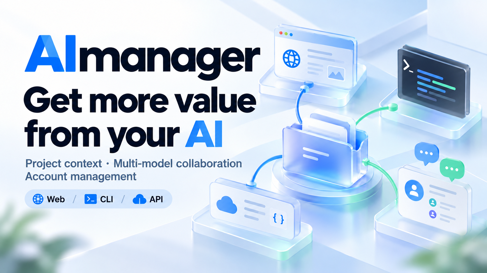
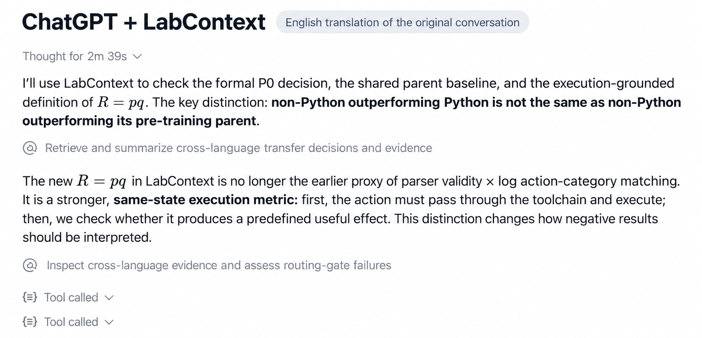
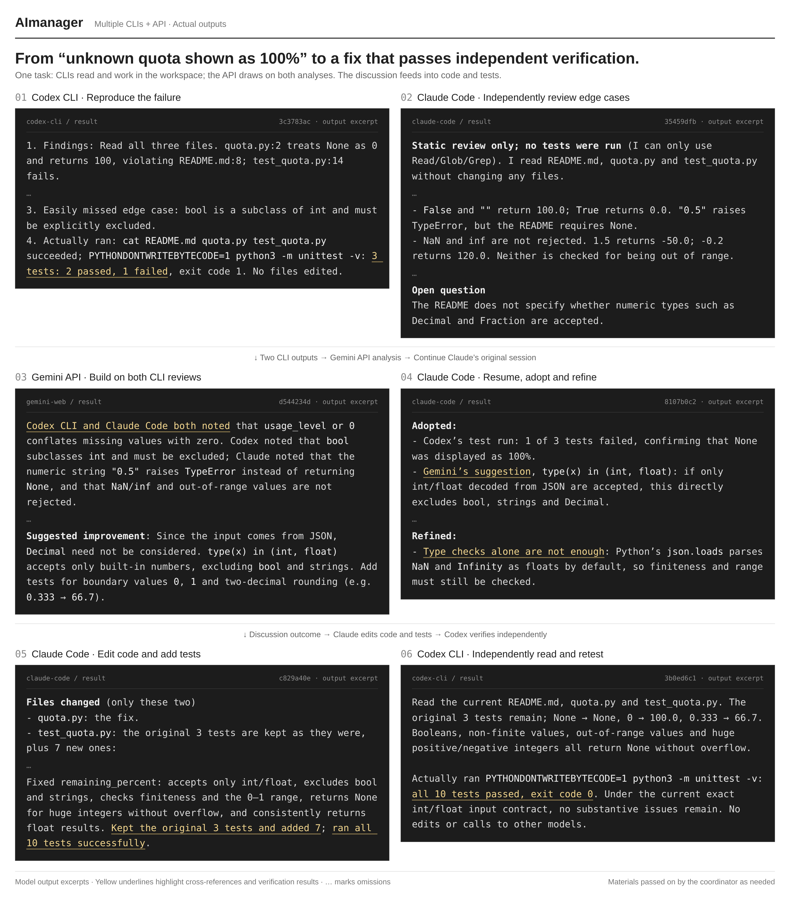
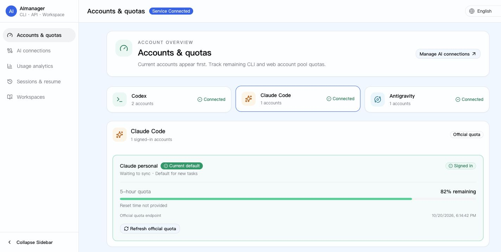
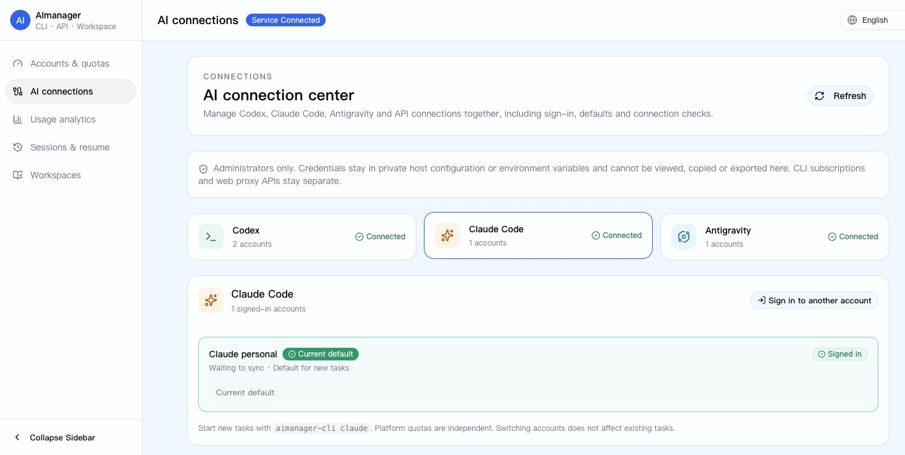
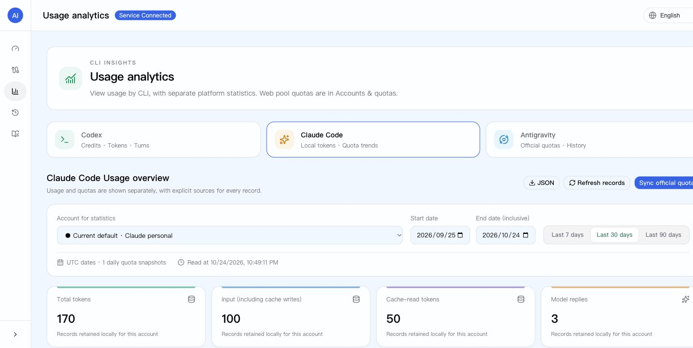
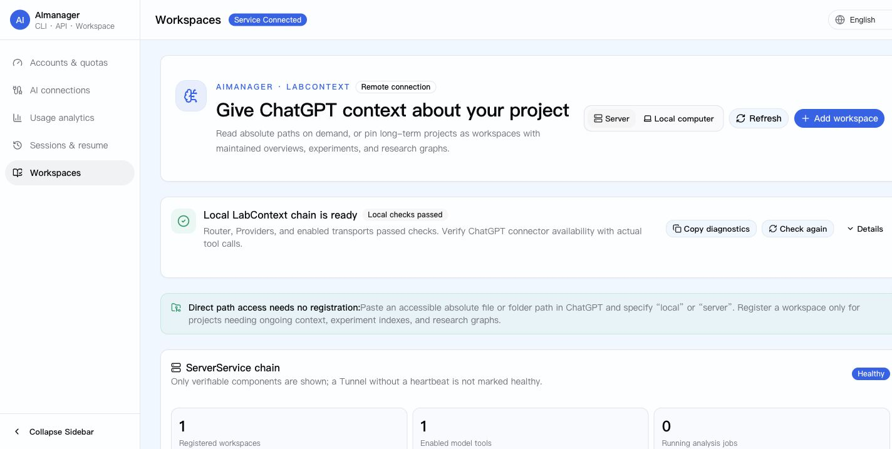

<h1 align="center">AImanager</h1>

<p align="center"><a href="README.md">English</a> · <a href="README.zh-CN.md">简体中文</a> · <a href="README.ru.md">Русский</a> · <strong>한국어</strong></p>

<h3 align="center">AI의 가치를 더 크게 활용하세요</h3>

<p align="center">ChatGPT에 실제 프로젝트 맥락을 연결하고,<br />CLI 에이전트와 API 모델이 함께 개발하고 교차 검토하도록 하세요.</p>

<p align="center"><a href="https://github.com/3241288994/AImanager/actions/workflows/ci.yml"></a> · <a href="LICENSE">MIT License</a></p>

<p align="center"></p>

**프로젝트 맥락 연결, 다중 모델 개발·검토, AI 계정 관리.**

MCP를 통해 ChatGPT가 내 컴퓨터와 서버에서 허용된 코드, 논문, 실험 파일을 읽게 할 수 있습니다. 프로젝트를 반복해서 압축하거나 업로드할 필요가 없습니다.
기존 에이전트에서 Codex CLI, Claude Code, API 모델을 호출하고 필요한 자료와 분석·테스트 결과를 전달하여 설계를 비교하고, 승인된 코드를 수정하고, 결과를 교차 검토합니다.
로그인, 계정 선택, 플랫폼별 한도, 사용 기록, CLI 세션 복구도 한 화면에서 관리합니다.

## 실제 활용 흐름

### ChatGPT가 프로젝트 파일을 근거로 답변

원래 대화에서는 ChatGPT가 LabContext로 실험 결정과 근거를 검색한 뒤 결과를 설명했습니다. 아래 이미지는 **해당 대화의 영어 번역본**이며, 새로 실행한 화면이 아닙니다.



**경로 전달 → 디렉터리 확인 → 핵심 파일 읽기 → 프로젝트 또는 실험 결과 설명.**
허용된 경로를 일회성으로 읽을 때는 워크스페이스 등록이 필요하지 않습니다. 지속적으로 맥락을 관리하려면 프로젝트를 워크스페이스로 등록하세요.
[ChatGPT 연결](docs/open-source/03-openai-plugin-and-tunnel.md) · [읽기 허용 경로](docs/local-workspaces.md)

### CLI와 API가 의견을 교환하고 수정·검증



[원본 해상도: 3360 × 3814](docs/assets/en/aimanager-collaboration-demo.png?raw=true)

격리된 예제에서 수집한 모델 출력 발췌 이미지의 영어 번역본입니다. 6단계 구성, 코드, 노란색 강조를 유지했고 생략은 …로 표시했습니다. 별도의 영어 재실행 결과는 아닙니다.
Codex가 실패를 재현하고 Claude가 경계 사례를 독립 검토합니다. Gemini는 두 분석을 비교하고, Claude는 제안을 수용·보완한 뒤 새로 승인된 작업에서 코드를 수정합니다. Codex가 독립 재검증하고 주 에이전트가 확인한 기록에서는 **10개 테스트가 모두 통과했습니다**.

주 에이전트가 필요한 자료만 전달합니다. API 모델에 무제한 파일 접근 권한을 주지 않으며, 편집과 실행에는 명시적 승인이 필요합니다.
[재현 예제와 호출 기록](docs/demos/collaboration-demo.md) · [협업 안내](docs/ai-collaboration.md) · [검증 범위](docs/collaboration-validation.md)

## AImanager를 사용하는 이유

- **익숙한 에이전트를 그대로 사용합니다.** 공통 Skill과 가벼운 호출 도구로 협업하며 별도 상시 스케줄링 플랫폼이 필요하지 않습니다.
- **실제 자료로 서로의 결론을 검토합니다.** CLI는 워크스페이스를 살펴보고, API는 선택된 맥락을 받으며, 결과와 의견 차이를 참여 모델에 다시 전달합니다.
- **작업 레시피를 재사용합니다.** 독립 검토, 계획·실행, 연구 토론, 글쓰기의 네 가지 레시피를 제공하며 직접 조정할 수 있습니다.

실제 협업 결과에서 레시피를 자동 추출·검증·갱신하는 기능은 **계획 단계이며 아직 구현되지 않았습니다**.

## 요청 예시

```text
내 컴퓨터의 /Users/me/Documents/project를 확인해 주세요.
진입 파일을 찾고 프로젝트 구조를 설명해 주세요.

서버의 /srv/research/paper-a/README.md와 results 디렉터리를 읽고
현재 실험 진행 상황을 요약해 주세요.

opus5.5와 각각 해결책을 제안한 뒤 핵심 차이를 토론하고,
합의한 변경을 적용해 주세요.
```

경로는 허용 범위 안에 있어야 합니다. `opus5.5`, `gemini4`는 사용자 설정 별칭의 예시이며 특정 모델의 제공을 보장하지 않습니다.
웹에서 협업을 시작하려면 별도 MCP 브리지 정책을 활성화해야 하며 실행 권한은 기본적으로 꺼져 있습니다.

## 협업을 구성하는 세 부분

| 구성 요소 | 역할 |
| --- | --- |
| 공통 Skill | 작업 분담, 맥락 준비, 토론, 결과 검증 |
| `ai-collab` | CLI/API 호출, 작업 제출, 결과 조회, 대화 이어가기, 권한 범위 적용 |
| 작업 레시피 | 재사용 가능한 자료 요구 사항, 역할, 검증 단계 |

역할이나 토론 횟수는 고정하지 않습니다. 중요한 결정은 먼저 독립적으로 판단하고, 사실은 출처로, 추론은 전제로, 선택은 사용자 요구 사항으로 확인합니다.

## 계정·한도·세션 관리

| 기능 | 제공 내용 |
| --- | --- |
| AI 연결 | Codex, Claude Code, Antigravity 로그인과 계정 선택, 비공개 API 및 연결 검사 |
| 계정 한도 | 플랫폼별 한도 구간, 초기화 시각, 최근 스냅샷 |
| 웹 계정 풀 | 지원되는 풀의 가용 상태, 요금제, 한도, 오래된 데이터 식별 |
| 사용 분석 | 각 플랫폼에서 실제로 수집 가능한 사용량과 한도 이력 |
| 세션 복구 | 서비스 호스트의 세션 검색과 계정별 재개 명령 |
| 워크스페이스 | 개요, 근거, 실험, 분석 작업, 연구 그래프 |
| 연결 진단 | Router, Provider, SSH, Tunnel 점검과 안전한 복구 |

알 수 없는 값은 그대로 표시합니다. Codex는 Credits, 토큰, 기록, JSON/CSV 내보내기와 USD 참고 추정치를 제공합니다. Claude 토큰 통계는 서비스 호스트에 저장된 세션 로그를 사용합니다. Antigravity는 신뢰할 만한 토큰 데이터가 없으면 한도 스냅샷을 표시합니다.
**서로 다른 플랫폼의 한도를 합산하지 않으며 참고 금액은 실제 청구서가 아닙니다.**



<details>
<summary>AI 연결, 사용 분석, 워크스페이스 더 보기</summary>







</details>

위 캡처는 영어 UI의 일부 화면이며 격리된 데모 데이터를 사용합니다. 실제 계정이나 잔여 한도를 나타내지 않습니다. 이 언어판의 이미지는 모두 영어 자료를 공유합니다.

## 설치

| 모드 | 읽기 범위 |
| --- | --- |
| `local` | 명시적으로 허용한 내 컴퓨터의 디렉터리 |
| `server` | 명시적으로 허용한 서버의 디렉터리 |
| `hybrid` | 하나의 ChatGPT 연결로 두 위치 모두 사용 |

Provider는 파일을 읽고 Router는 도구를 라우팅하며 Tunnel은 비공개 MCP 연결을 제공합니다. 호스트별 접근 범위는 각각 설정합니다.
코드·텍스트, HTML, 텍스트 PDF, DOCX, XLSX, PPTX, IPYNB를 지원합니다. 스캔 문서는 OCR이 필요하며 크기·디렉터리 깊이·응답 예산 제한이 적용됩니다.

사용 중인 코딩 에이전트에 다음과 같이 요청하세요.

```text
https://github.com/3241288994/AImanager 를 설치하거나 업그레이드해 주세요.
모드: <local | server | hybrid>
SSH Host: <기존 별칭, local 모드는 생략>
허용 경로: <로컬과 서버 각각의 절대 경로>

먼저 AGENTS.md, INSTALL.md 및 연결된 안내를 읽어 주세요.
기존 계정, 데이터베이스, 설정, 비밀 정보를 보존하고 기존 SSH를 사용하세요.
ai-collab 지원 여부를 확인하고 제가 지정한 승인된 채널만 설정하세요.
공식 사이트에서 제가 직접 인증해야 할 때 구체적인 절차를 안내하세요.
설치 문서의 검증 항목을 실행하고 결과를 보고하세요.
```

전체 설치 절차는 [INSTALL.md](INSTALL.md)에 있습니다. 상세 운영 문서는 현재 주로 중국어이며, 각 언어 README는 진입 안내를 제공합니다.

현재 공개된 협업 실행 도구는 **Linux와 Python 3.8+**가 필요합니다.

```bash
python3 scripts/install-ai-collab.py
ai-collab init
ai-collab doctor
ai-collab resolve opus5.5
ai-collab run --model opus5.5 --workspace /path/to/project --prompt "Review this project"
ai-collab wait JOB_ID --timeout 30
ai-collab result JOB_ID
ai-collab reply JOB_ID --prompt "Suggest specific improvements"
```

`~/.local/bin`을 `PATH`에 추가하세요. Skill은 기본적으로 Codex 디렉터리에 설치되며 다른 주 에이전트에는 `--skill-dir`을 사용하고 새 세션을 시작하세요.
`doctor`는 연결 전제 조건을 검사하며 작업 결과의 정확성을 보장하지 않습니다. 편집·실행 권한은 명시적으로 설정해야 합니다.
Codex CLI, Claude Code, Gemini API 어댑터가 제공됩니다. Antigravity **계정 관리 지원이 협업 실행 어댑터 지원을 뜻하지는 않습니다**. Linux 요구 사항은 공개된 협업 실행 도구에 관한 것이며 모든 구성 요소에 해당하지 않습니다.

## 복구와 보안

```bash
labcontext status
labcontext doctor
labcontext repair
```

연결 센터에서도 복구할 수 있습니다. 이후 ChatGPT 계정을 바꿀 때를 위해 Tunnel 프로필은 워크스페이스와 분리됩니다. [계정 전환 안내](docs/chatgpt-account-switch.md)를 참고하세요.

- 명시적으로 허용된 디렉터리만 개방하세요. 읽기 권한이 임의 실행 권한을 의미하지 않습니다.
- 관리 RPC, 데이터베이스, 토큰을 공개하지 마세요. 기본 배포는 loopback에서 수신합니다.
- 비밀 정보와 운영 설정을 Git에 넣지 마세요. 전송한 맥락에는 선택한 모델 제공자의 데이터 정책이 적용됩니다.
- ChatGPT는 관리 RPC가 아닌 Router의 MCP에 연결됩니다. 워크스페이스 경로 자체가 완전한 컨테이너 격리 경계는 아닙니다.

## 문서와 개발

[설치](INSTALL.md) · [워크스페이스](docs/local-workspaces.md) · [계정](docs/ai-connections.md) · [협업](docs/ai-collaboration.md) · [분석](docs/usage-analytics.md) · [세션](docs/cli-sessions.md) · [테스트](TESTING.md)

소스 빌드는 Node.js 20+, Python 3.11+, Rust stable이 필요하며 데스크톱 패키징에는 플랫폼별 Tauri 의존성도 필요합니다.

```bash
corepack pnpm@10.30.3 -C apps install --frozen-lockfile
corepack pnpm@10.30.3 -C apps run build:desktop
corepack pnpm@10.30.3 -C apps run test:runtime
cargo test --workspace --locked -- --test-threads=1
scripts/open-source/preflight.sh
```

UI와 데스크톱: `apps/`; 서비스와 저장소: `crates/`; 파일과 맥락: `labcontext-provider/`; 어댑터: `scripts/ai_collab/`; Skill과 레시피: `skills/multi-model-collaboration/`.

## 라이선스와 출처

[MIT License](LICENSE). MIT 라이선스의 `qxcnm/Codex-Manager` 코드를 기반으로 발전한 프로젝트입니다. [NOTICE](NOTICE)와 [THIRD_PARTY_NOTICES.md](THIRD_PARTY_NOTICES.md)를 참고하세요.
[기여 안내](CONTRIBUTING.md) · [보안 문제 신고](SECURITY.md).

제품과 저장소 이름은 **AImanager**입니다. 기존 `codexmanager-*` 바이너리, 환경 변수, 데이터 경로는 호환성을 위해 유지되므로 운영 데이터를 임의로 이름 변경하거나 이동하지 마세요.
