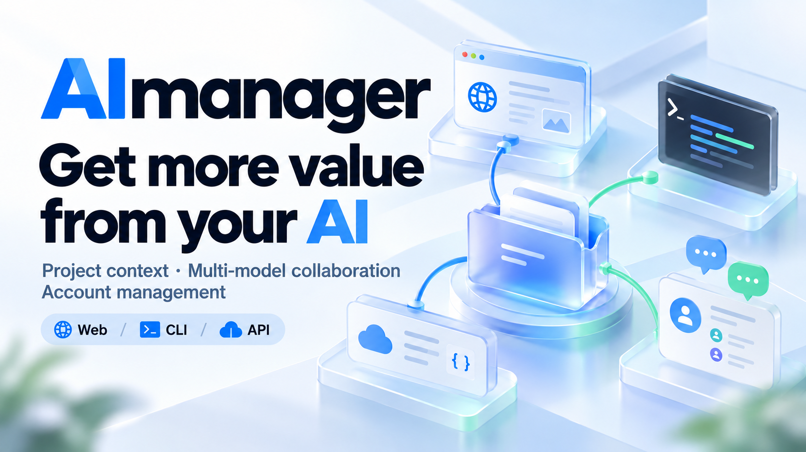
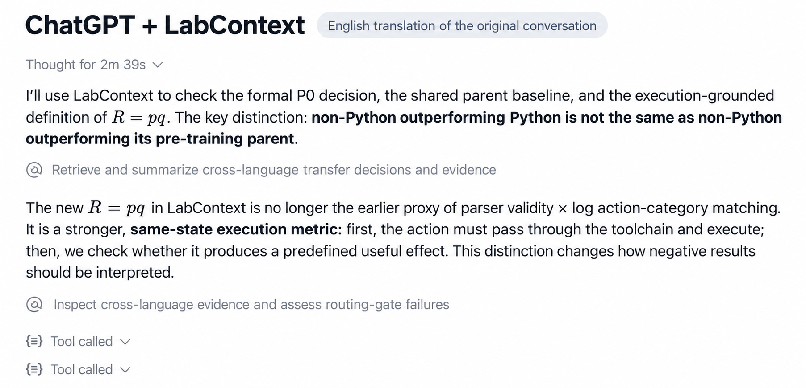
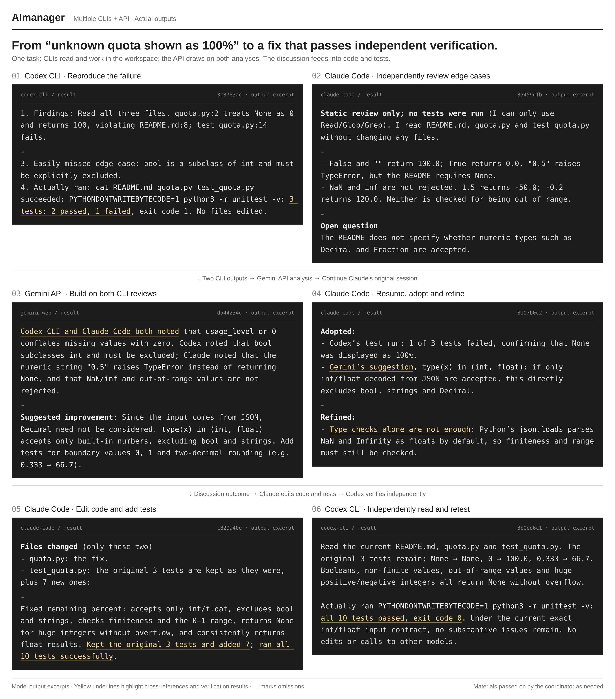
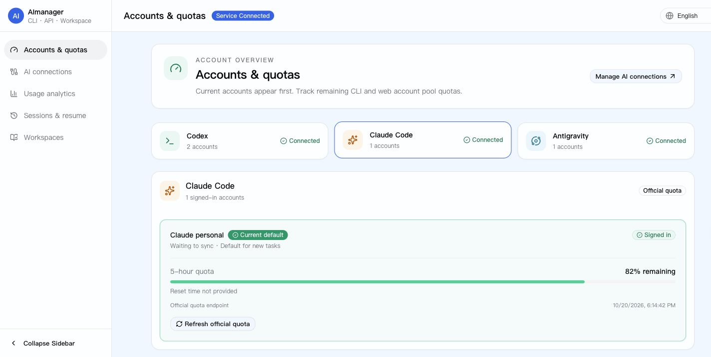
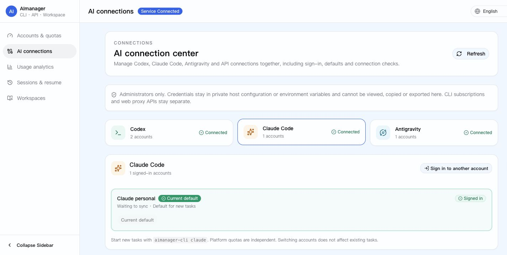
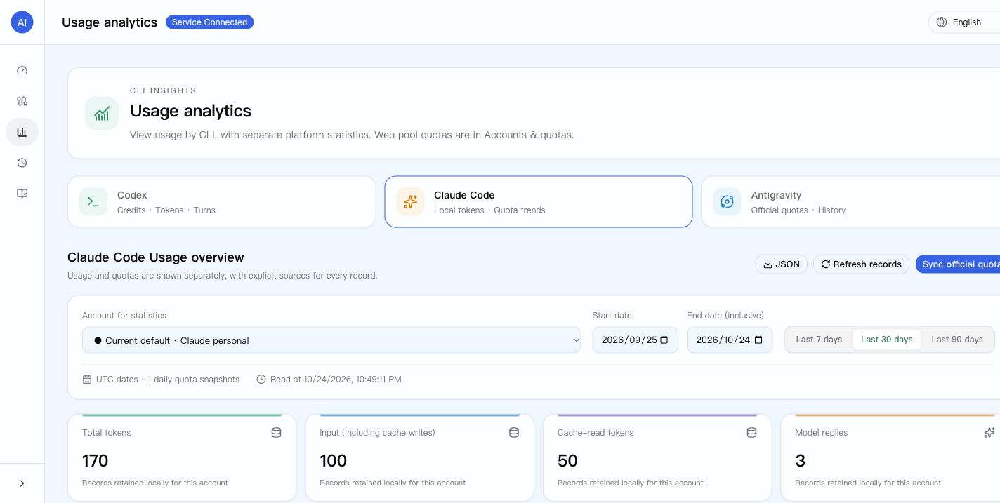
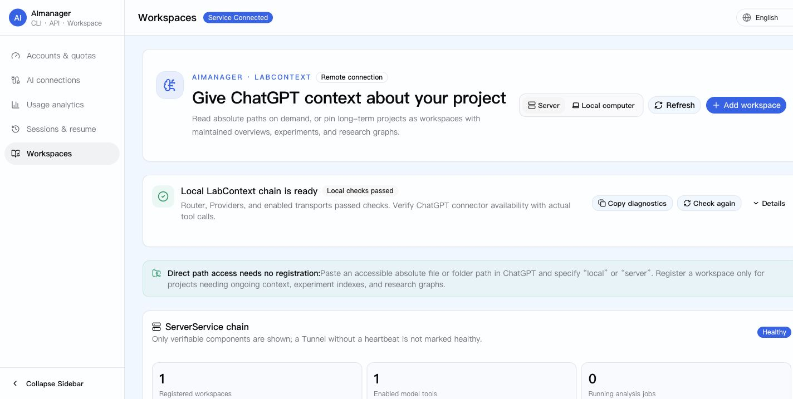

<h1 align="center">AImanager</h1>

<p align="center"><strong>English</strong> · <a href="README.zh-CN.md">简体中文</a> · <a href="README.ru.md">Русский</a> · <a href="README.ko.md">한국어</a></p>

<h3 align="center">Get more value from your AI</h3>

<p align="center">Give ChatGPT access to your project context.<br />Let CLI agents and API models develop, discuss, and review together.</p>

<p align="center">
  <a href="https://github.com/3241288994/AImanager/actions/workflows/ci.yml"></a>
  <a href="LICENSE"></a>
</p>

<p align="center"><a href="#see-it-in-action"><strong>See it in action</strong></a> · <a href="#get-started">Get started</a> · <a href="docs/ai-collaboration.md">Collaboration</a> · <a href="docs/local-workspaces.md">Workspaces</a> · <a href="docs/ai-connections.md">Accounts & connections</a></p>

<p align="center"></p>

**Project context, multi-model development and review, and AI account management.**

Let ChatGPT read authorized code, papers, and experiment files on your computer or server through MCP, without repeatedly packaging and uploading projects.
From your existing agent, call Codex CLI, Claude Code, and API models. Share selected materials, analyses, and test results to compare approaches, modify code, cross-review changes, and continue each participant's conversation.

Manage sign-in, account selection, platform quotas, usage records, and CLI session recovery in one interface.

## See it in action

### ChatGPT: answer questions using project files

In the original conversation, ChatGPT used LabContext to retrieve experiment decisions and evidence, then interpreted the results using workspace materials. Below is an **English translation of that conversation**, not a new live execution screenshot.

<p align="center"></p>

[Original Chinese screenshot](docs/assets/chatgpt-labcontext-demo.png)

You can also paste an authorized local or server path: **provide a path → inspect the directory → read key files → explain the project or experiment**.
One-off reads do not require registration. Register a workspace when you want maintained project context.
[Connect ChatGPT](docs/open-source/03-openai-plugin-and-tunnel.md) · [Configure readable directories](docs/local-workspaces.md)

### Collaboration: exchange analyses, implement a fix, verify independently

Codex CLI reproduces a failure, Claude Code independently reviews edge cases, and a Gemini API model compares both analyses. The coordinating agent passes relevant disagreements back for discussion, delegates authorized edits, and checks the resulting diff and tests.

<p align="center"></p>

[Full-resolution image — 3360 × 3814](docs/assets/en/aimanager-collaboration-demo.png?raw=true)

This is the **English-localized version of the original output-excerpt montage** from an isolated example. It preserves the six steps, code, and yellow annotations; ellipses mark omissions. It is not a separate English-language rerun.
Gemini references both CLI analyses; Claude adopts and refines the suggestions, then modifies the code in a newly authorized task. Codex independently retests, and the coordinator checks again: **all 10 tests pass in the recorded example**.

Roles are adjustable. API models receive selected text, not unrestricted workspace access. Editing and execution require explicit authorization.
[Reproducible example and records](docs/demos/collaboration-demo.md) · [Collaboration guide](docs/ai-collaboration.md) · [Validation scope](docs/collaboration-validation.md)

## Why AImanager

### Use multiple models from the agent you already know

Install a shared skill and a lightweight invocation tool in your existing agent. Choose the coordinator, participants, and workspace for each task without adding an always-on scheduling platform.
Personal configuration maps model aliases to providers; collaboration rules do not depend on one model version. New CLI and API providers can be added through adapters.

### Review plans and results against project evidence

Web AI reads authorized project materials through tools. CLI collaborators inspect files and, when authorized, edit and run checks. API models work from selected context for design, review, reasoning, and writing.
Exchange plans, evidence, and results between participants instead of manually copying every answer.

### Reuse task recipes

Four editable recipes cover independent review, planning and execution, research discussion, and writing. They record input requirements, responsibilities, and verification steps.
**Planned, not implemented:** automatically extracting, validating, and updating recipes from everyday collaboration outcomes.

## Start with a request

After configuration, replace these paths and aliases with your own.

### Inspect local or server projects in ChatGPT

```text
Inspect /Users/me/Documents/project on my local computer.
Find the entry points and explain the project structure.

Read /srv/research/paper-a/README.md on the server and use the results
directory to summarize the current experiment progress.
```

LabContext identifies the source, returns a bounded directory tree, and reads relevant files on demand. Paths must be within authorized roots. Register a workspace only when you need ongoing context.

### Collaborate by model name in your current agent

```text
Work with opus5.5 on this project. Propose approaches independently,
discuss the important differences, and implement the agreed changes.

Ask gemini4 to review this experiment design, focusing on controls
and alternative explanations.
```

`opus5.5` and `gemini4` are **example aliases**, not guaranteed model availability.
The coordinator supplies context, grants permissions, and verifies results. CLI collaborators work in the specified workspace; API collaborators receive selected material. Conversations can be resumed.
Starting collaboration from the web requires the optional MCP bridge policy; execution is disabled by default.

| Task | How models can work together |
| --- | --- |
| Papers and reports | Read drafts and result tables; review arguments, facts, and wording |
| Research | Compare ideas and evidence; test alternative explanations; refine experiments |
| Development | Inspect implementations, edit files, run checks, and independently review results |
| Everyday work | Analyze documents, spreadsheets, and project materials; prepare deliverables |

## Three lightweight collaboration components

| Component | Responsibility | Value |
| --- | --- | --- |
| **Shared skill** | Task division, context preparation, discussion, and verification | Consistent working principles across coordinating agents |
| **`ai-collab` tool** | Invoke CLI/API providers, submit tasks, retrieve results, resume conversations, and enforce permission scopes | Less manual command construction and result forwarding |
| **Task recipes** | Reusable inputs, roles, steps, and applicability notes | Adjustable starting points for recurring work |

**Workspaces provide context; the skill organizes collaboration; the tool connects models and execution environments; recipes preserve useful practices.**

Use independent judgment before resolving consequential disagreements. Check sources for facts, assumptions for reasoning, and user requirements for trade-offs. No fixed roles or discussion-round count is required.
[Collaboration guide](docs/ai-collaboration.md) · [Discussion guidance](skills/multi-model-collaboration/references/discussion.md) · [Validation records](docs/collaboration-validation.md)

## One interface for everyday AI use

| Feature | What it does |
| --- | --- |
| AI connections | Manage Codex, Claude Code, and Antigravity sign-in/account selection, private API endpoints, and connection checks |
| Accounts & quotas | Show platform-specific windows, reset times, and snapshots; highlight verified active accounts |
| Web account pools | Show supported pools' availability, plans, and quota windows; distinguish stale data and failed probes |
| CLI analytics | Inspect the usage or quota history each platform actually exposes |
| Sessions & recovery | Search sessions on the service host and copy account-specific resume commands |
| Workspaces | Maintain overviews, evidence, experiments, analysis jobs, and research graphs |
| Connection center | Check Router, Provider, SSH, and Tunnel; offer safe repair, diagnostics, and manual recovery guidance |

Missing metrics remain unknown. Codex exposes daily Credits, tokens, interaction history, JSON/CSV exports, and reference USD estimates. Claude token statistics come from retained session logs on the service host. Antigravity uses quota snapshots when reliable token data is unavailable.
**Reference amounts are not bills, and quotas from different platforms are not added together.**
[Connections and quotas](docs/ai-connections.md) · [Analytics](docs/usage-analytics.md) · [Session recovery](docs/cli-sessions.md)

Codex accounts can switch across the server and paired Macs with independent authorization.
Idle sessions can stay open; active tasks defer switching, with checks every two seconds.
Current Free entitlements take precedence over old billing labels; confirmed monthly Pro tiers can appear as `Pro 200$`.
[Codex sign-in, device pairing, switching, and plan labels](docs/codex-account-activation.md)

## Local, server, or both

| Mode | Read access | Typical use |
| --- | --- | --- |
| `local` | Explicitly authorized directories on your computer | Personal projects and documents |
| `server` | Explicitly authorized server directories | Remote development, research, and experiments |
| `hybrid` | Local and server directories through one ChatGPT connection | Local writing with remote development or computation |

Configure access separately on each host and deploy only the components you need. The Provider reads files and projects; the Router routes tools between sources; the Tunnel provides the private MCP connection. Collaboration can also run independently through the CLI.

**Direct paths** suit one-off inspection. **Registered workspaces** retain overviews, evidence indexes, experiment records, and research relationships.
Both share parsers and file-type allowlists: common code/text, HTML, text-based PDF, DOCX, XLSX, PPTX, and IPYNB. Scanned PDFs require OCR; size, depth, and response budgets still apply. See [file-reading boundaries](docs/local-workspaces.md).

## Get started

### Ask your coding agent to install it

Replace the placeholders and give this to an agent that can operate the target devices:

```text
Install or upgrade https://github.com/3241288994/AImanager .

Mode: <local | server | hybrid>
Server SSH Host: <existing SSH alias; omit for local mode>
Allowed local directories: <absolute paths; omit for server mode>
Allowed server directories: <absolute paths; omit for local mode>

Read AGENTS.md, INSTALL.md, and the relevant linked documentation first.
Reuse existing SSH configuration. Preserve accounts, databases,
configuration, and credentials. Complete the documented verification steps.
Read docs/ai-collaboration.md and check whether this environment supports
the collaboration tools. If supported, install the skill and configure only
the models and authorized providers I specify.
Give me explicit steps whenever official browser authorization is required.
```

[INSTALL.md](INSTALL.md) is the complete installation contract. Detailed operational documents are currently primarily in Chinese; these README editions provide localized entry points. Use your own accounts and explicitly authorized directories.

### Add collaboration to an existing setup

The published collaboration execution tool currently requires **Linux and Python 3.8+**. From the repository root:

```bash
python3 scripts/install-ai-collab.py
ai-collab init
ai-collab doctor

ai-collab resolve opus5.5
ai-collab run --model opus5.5 --workspace /path/to/project \
  --prompt "Review the project structure and identify the highest-priority issues"
ai-collab wait JOB_ID --timeout 30
ai-collab result JOB_ID
ai-collab reply JOB_ID --prompt "Suggest specific changes based on these findings"
```

Configure providers using the [guide](docs/ai-collaboration.md), and include `~/.local/bin` in `PATH`. The installer defaults to the Codex skill directory; use `--skill-dir` for another coordinating agent. New skills usually require a new session.
`doctor` checks configuration and connectivity prerequisites, not task correctness. Editing/execution needs explicit permissions. Replace `JOB_ID` with the returned identifier.

## Interface preview

English UI captures use **isolated demonstration data**. Names, paths, health states, quotas, and usage figures are examples, not live account data. Images are viewport excerpts, not complete pages.

### Accounts & quotas



<details>
<summary>More: AI connections, analytics, and workspaces</summary>

### AI connections



### CLI analytics



### Workspaces and connection checks



</details>

## Support and roadmap

| Capability | Status |
| --- | --- |
| Local/server reads, workspaces, diagnostics, repair | Available with the selected deployment mode and permissions |
| Codex, Claude Code, Antigravity accounts, quotas, sessions | Available; coverage depends on CLI, account, and environment |
| Claude Code, Codex CLI, Gemini API collaboration | Adapters available; the published execution tool requires Linux |
| Antigravity collaboration execution | No dedicated adapter yet; account support does not imply collaboration support |
| Native CLI/API continuation; optional MCP bridge | Available; MCP execution disabled by default |
| Four editable task recipes | Available |
| Automatic recipe extraction, validation, and updates | Planned |
| More providers and cross-platform collaboration | Ongoing work |

See [validation records](docs/collaboration-validation.md) for tested scope. The collaboration tool's Linux requirement does not mean that all workspace components are Linux-only.

## Diagnostics and security boundaries

Use **Repair** in the connection center, or run:

```bash
labcontext status
labcontext doctor
labcontext repair
```

`repair` runs recovery in the background and prints only the verified connection result or failure reason.
Use `labcontext repair --verbose` for diagnostic details and the log location.
Recovery bounds the old-stack check, combines SSH probes, and records stage timings without accepting a cached success after a timeout.

Tunnel connection profiles are managed separately in the backend so later ChatGPT account changes can target the access layer without reinstalling workspaces. See [account-switch recovery](docs/chatgpt-account-switch.md); this does not add a frontend account-switch panel.

- Expose only explicitly authorized directories; retain file-size, depth, and response budgets.
- Default deployments listen on loopback. Do not publish management RPC, databases, account tokens, or Provider admin tokens.
- Keep credentials, databases, and runtime configuration out of the public repository. Selected model providers' data policies apply to submitted context.
- ChatGPT connects to the Router's MCP endpoint, not the AImanager management RPC.
- Read access does not grant arbitrary execution; MCP policies determine exposed operations.
- CLI execution is constrained by adapters and native sandboxes. A workspace path is not a complete container-isolation boundary.

[Router](docs/labcontext-router.md) · [ChatGPT and Tunnel](docs/open-source/03-openai-plugin-and-tunnel.md) · [Security policy](SECURITY.md)

## Documentation and development

| Topic | Documentation |
| --- | --- |
| Installation and upgrades | [INSTALL.md](INSTALL.md) |
| Server deployment | [Deployment guide](docs/open-source/01-server-deployment.md) |
| Workspaces and file reading | [Workspace guide](docs/local-workspaces.md) |
| Accounts and naming compatibility | [Connections](docs/ai-connections.md) |
| Collaboration | [Usage](docs/ai-collaboration.md) · [Design](docs/collaboration-runtime-design.md) |
| Usage and sessions | [Analytics](docs/usage-analytics.md) · [Session recovery](docs/cli-sessions.md) |
| Testing and release | [TESTING.md](TESTING.md) · [Release checklist](docs/open-source/04-public-release-checklist.md) |

Source builds require Node.js 20+, Python 3.11+, and Rust stable. Desktop packaging also needs platform-specific Tauri dependencies.

```bash
corepack pnpm@10.30.3 -C apps install --frozen-lockfile
corepack pnpm@10.30.3 -C apps run build:desktop
corepack pnpm@10.30.3 -C apps run test:runtime
cargo test --workspace --locked -- --test-threads=1
scripts/open-source/preflight.sh
```

```text
apps/                            Next.js UI and Tauri desktop shell
crates/                          Accounts, quotas, usage, sessions, storage, Web service
labcontext-provider/             File readers, workspaces, project context
scripts/labcontext*.py           Router, SSH bridge, launch and diagnostics
scripts/ai_collab/               Provider adapters, tasks, conversation continuation
skills/multi-model-collaboration/ Shared skill and optional recipes
deploy/                          Deployment examples
docs/                            Guides, designs, and validation records
```

## Contributing, license, and attribution

Contributions of CLI/API adapters, recipes, cross-platform support, and practical feedback are welcome. Read [CONTRIBUTING.md](CONTRIBUTING.md); report vulnerabilities through [SECURITY.md](SECURITY.md).

Licensed under the [MIT License](LICENSE), evolved from MIT-licensed `qxcnm/Codex-Manager`. See [NOTICE](NOTICE) and [THIRD_PARTY_NOTICES.md](THIRD_PARTY_NOTICES.md) for attribution and third-party notices.

The product and repository are named **AImanager**: [3241288994/AImanager](https://github.com/3241288994/AImanager).
Existing clones can run `git remote set-url origin https://github.com/3241288994/AImanager.git`.
Legacy `codexmanager-*` binaries, environment variables, database names, and configuration paths remain compatible; do not rename or migrate runtime data just to update the branding.
