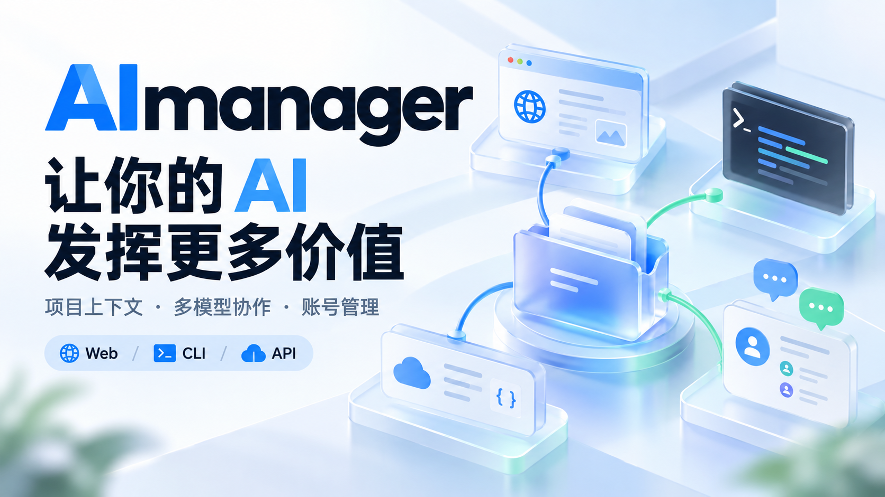
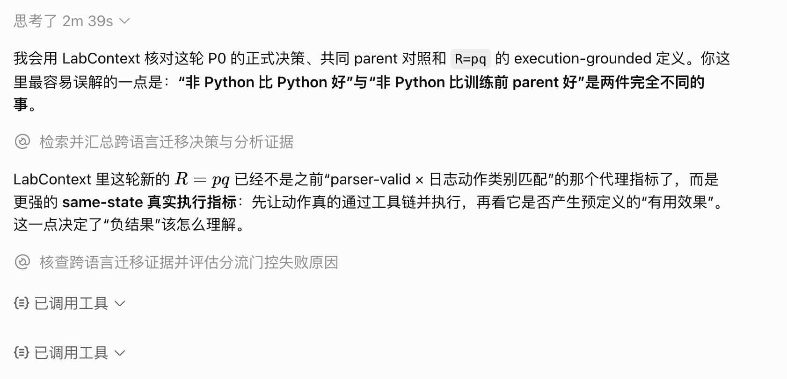
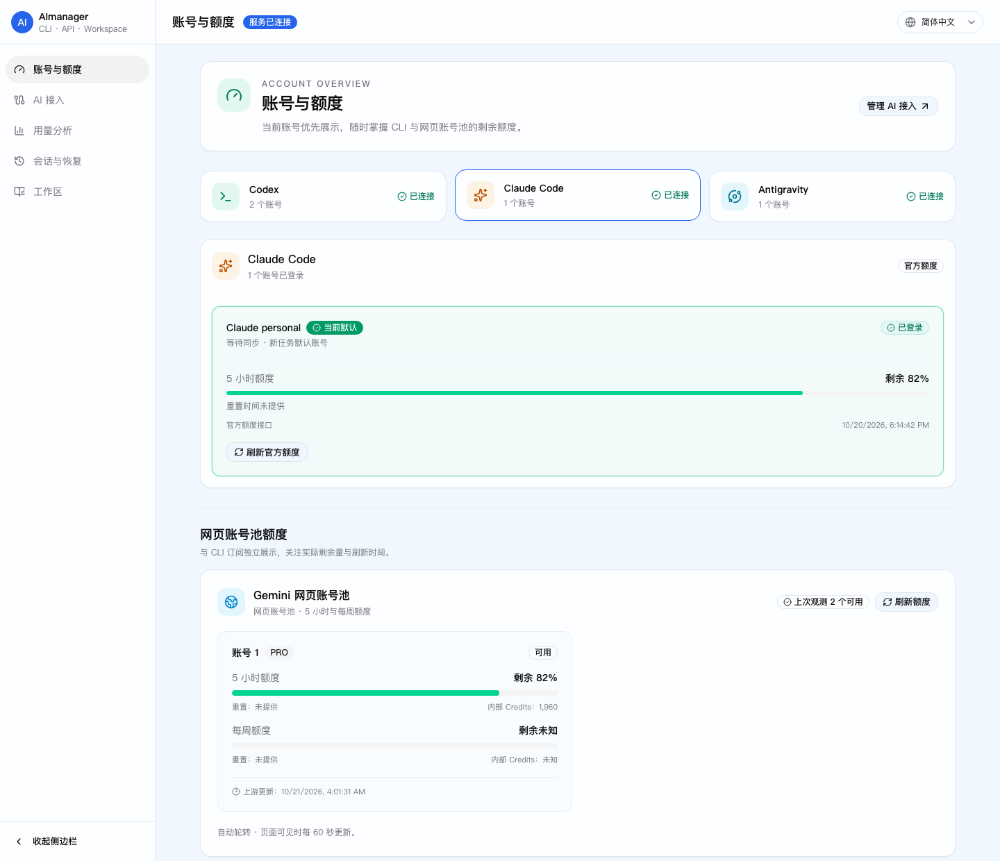
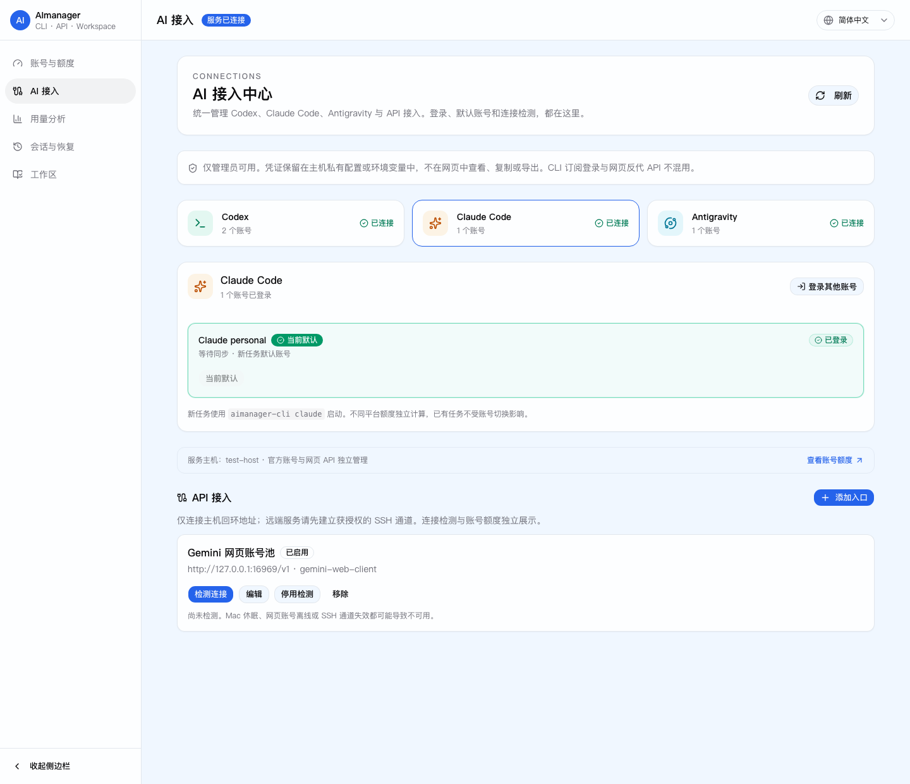
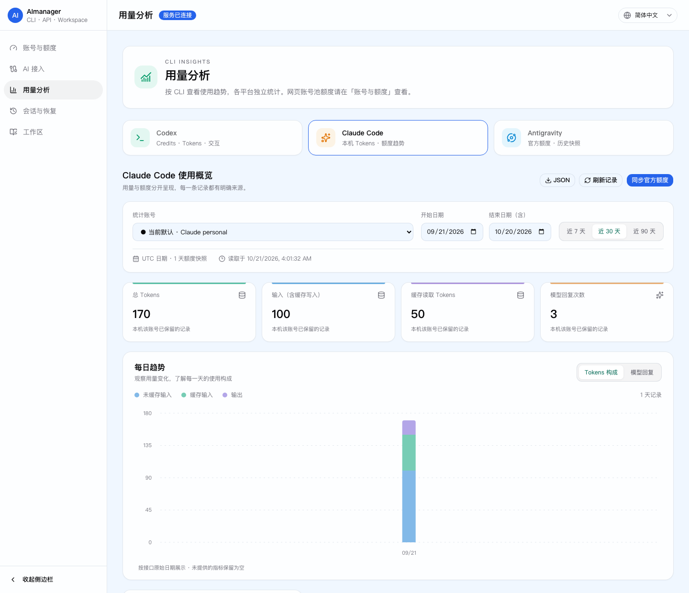
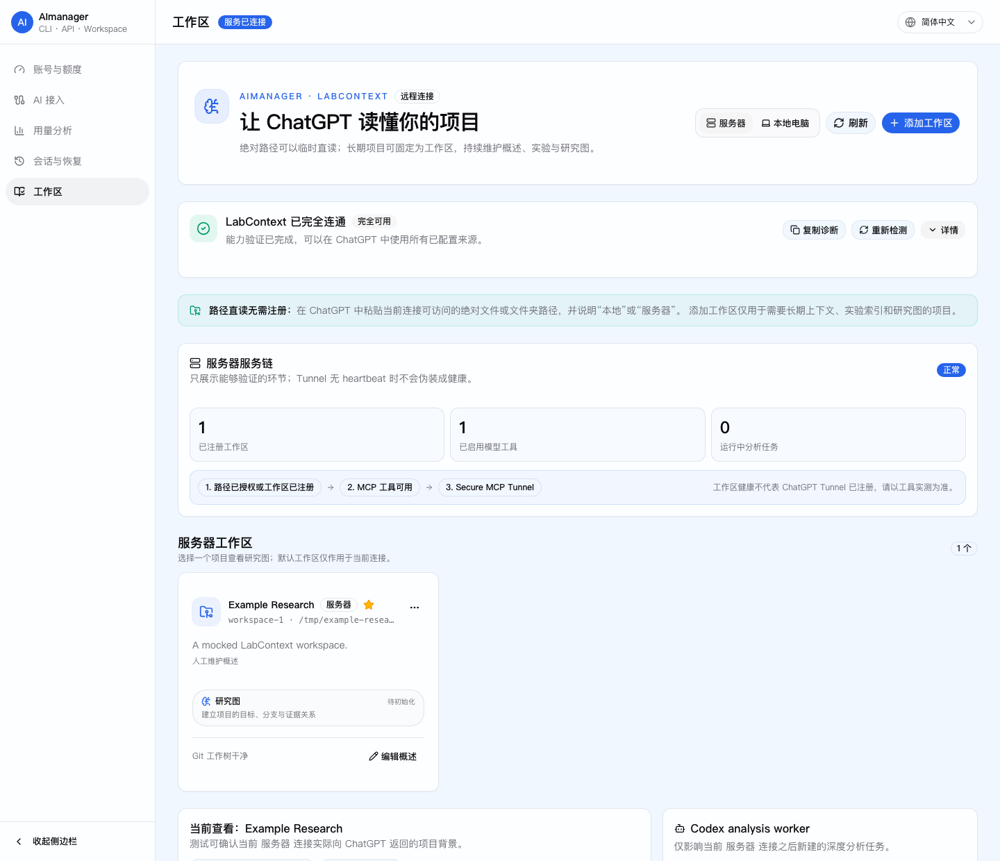

<h1 align="center">AImanager</h1>

<h3 align="center">让你的 AI 发挥更多价值</h3>

<p align="center">
  让 ChatGPT 网页版直接查看项目，<br />
  让命令行 Agent 与 API 模型协同开发、交叉审阅。
</p>

<p align="center">
  <a href="https://github.com/3241288994/AImanager/actions/workflows/ci.yml"></a>
  <a href="LICENSE"></a>
</p>

<p align="center">
  <a href="#先看实际效果"><strong>实际演示</strong></a> ·
  <a href="INSTALL.md">开始使用</a> ·
  <a href="docs/ai-collaboration.md">多模型协作</a> ·
  <a href="docs/local-workspaces.md">本地与服务器工作区</a> ·
  <a href="docs/ai-connections.md">AI 接入与账号管理</a>
</p>

<p align="center">
  
</p>

---

**项目上下文接入、多模型协作与 AI 账号管理。**

通过 MCP 插件，让 ChatGPT 网页版按需读取本机和服务器上的代码、论文与实验文件，无需反复打包上传。
在你当前使用的 Agent 中调用 Codex CLI、Claude Code 与 API 模型，按需传递项目材料、分析结论和测试结果，
完成方案对比、代码修改与交叉审阅，并继续各自的会话。

账号登录与切换、平台额度、用量记录和 CLI 会话恢复集中在一个界面，减少切换工具和手动转交结果的操作。

*Get more value from your AI: project context, multi-model development and review, and account management across web, CLI, and API tools.*

## 先看实际效果

### ChatGPT 网页版：调用插件，结合项目文件回答问题

下面是此前的**真实使用截图**：ChatGPT 调用 LabContext 检索实验决策与分析证据，
再根据工作区中的材料解释实验指标和结论，而不是只根据对话中的描述猜测。

<p align="center">
  
</p>

现在还可以直接粘贴已授权的本机或服务器路径：**给出路径 → 查看目录 → 读取关键文件 → 解释项目或实验结果**。
临时读取不需要先注册工作区；需要持续维护时，再保存为长期工作区。
[连接 ChatGPT](docs/open-source/03-openai-plugin-and-tunnel.md) · [配置可读目录](docs/local-workspaces.md)

### 多模型协作：多个 CLI 与 API 交换分析结果，再修改和验证

例如，让 Codex CLI 检查实现和测试，Claude Code 独立审阅方案，API 模型比较两者的建议；
主控 Agent 把关键分歧交回对应模型继续讨论，再将确认的方案交给获授权的 CLI 修改、运行检查，
最后核对代码差异与测试结果。

<p align="center">
  
</p>


上图是隔离示例的**模型原始输出节选截图拼接**，保留原话，省略处以 … 标记，步骤编号与重点下划线为后加标注。
Codex CLI 复现失败，Claude Code 独立审阅，Gemini API 引用双方分析并提出建议；
Claude 续接讨论、修正方案，再通过新的授权任务修改代码；Codex 独立复测，主控再次确认，最终 **10 项测试全部通过**。
图中可以直接看到 Gemini 引用两份 CLI 分析、Claude 说明采纳与修正、Codex 最后独立运行测试的原文。

分工可以调整；材料由主控按需转交，API 模型只接收选定文本。编辑和执行仍需明确授权。
[本次调用记录与可复现示例](docs/demos/collaboration-demo.md) · [协作使用说明](docs/ai-collaboration.md) · [真实调用验证记录](docs/collaboration-validation.md)

## 为什么使用 AImanager

### 在现有 Agent 中调用多个模型

在现有 Agent 中安装通用 skill 与轻量调用工具，即可组织多模型协作，无需新增常驻调度平台。
谁负责、哪些模型参与、在哪个工作区开展工作，都可以按任务调整。

模型别名与调用渠道由个人配置管理，协作规则不绑定某个模型版本。
已有适配器可以复用，新的 CLI 或 API 渠道可以继续扩展。

### 传递项目上下文，交叉审阅方案与执行结果

网页版 AI 可以通过授权工具读取本地和服务器的项目材料；CLI 协作者可以自主检索文件、分析问题，
并在授权范围内编辑和运行检查；API 模型基于相关材料参与设计、审阅、推理和写作。

方案、证据与执行结果可以在参与者之间传递。角色随任务调整，讨论能够围绕实际项目持续推进。

### 用任务配方复用分工与验证步骤

用可复用的配方记录某类任务的材料要求、分工方式和关键步骤，让类似工作有经验可循。
目前提供独立审阅、方案与执行、科研讨论、写作整理四份配方，支持按需使用和人工调整。

**后续规划：** 根据日常使用中的实际结果，自动提炼有效做法，保存适用条件与结果依据，
在再次使用后持续修订。自动提炼、验证与写回机制尚未实现。

## 从一句话开始

以下是配置完成后可以使用的任务示例，路径和模型别名请替换为自己的配置。

### 在网页版查看本地与服务器项目

```text
请查看本地电脑的 /Users/me/Documents/project，找到入口文件并解释项目结构。

请读取服务器 /srv/research/paper-a/README.md，结合 results 目录总结目前的实验进展。
```

通过 LabContext，ChatGPT 可以确认来源、查看有限目录树，再按需读取相关文件。
临时读取只需提供授权范围内的路径，无需先上传整个项目或注册工作区。
需要长期维护时，再将项目注册为工作区。

### 在当前 Agent 中按模型名协作

```text
请与 opus5.5 一起查看这个项目，分别提出方案，再讨论关键差异并落实修改。

请让 gemini4 审阅这份实验设计，重点检查对照设置与可能的替代解释。
```

主控准备必要材料、分配权限并核验结果；CLI 协作者进入指定工作区，
API 协作者接收选定内容。后续可以继续同一会话，或把结果交给另一模型分析。

`opus5.5`、`gemini4` 是示例别名，实际模型与渠道以个人配置为准。
网页版发起协作需要另外启用 MCP 桥接策略，执行权限默认关闭。

### 用在不同类型的工作中

| 场景 | 可以怎样配合 |
| --- | --- |
| 论文与报告 | 读取原稿和结果表，讨论论证结构，交叉检查事实与表达 |
| 科研探索 | 比较资料与候选思路，检查替代解释，结合工作区完善实验设计 |
| 开发与实验 | CLI 查看实现、修改文件和运行检查，其他模型审阅方案与结果 |
| 日常业务 | 围绕文档、表格和项目资料共同分析，整理方案与交付材料 |

## 三部分，组成一套轻量协作方式

| 组成 | 负责什么 | 为什么需要 |
| --- | --- | --- |
| **通用 Skill** | 任务分工、上下文准备、讨论方式与结果核验 | 减少重复说明，让不同主控沿用一致的协作原则 |
| **`ai-collab` 工具** | 调用 CLI/API、提交任务、获取结果、续接会话并落实权限范围 | 统一不同渠道的调用方式，减少手工拼命令和转交结果 |
| **协作配方** | 保存特定任务的材料要求、分工方式、关键步骤与适用条件 | 为类似任务提供可调整的起点，承接后续经验积累 |

**工作区接入提供项目上下文，Skill 组织协作，工具连接模型与执行环境，配方积累有效经验。**

讨论按任务需要展开：重要方案先独立判断，再聚焦影响决策的差异；事实查来源，推理查前提，
取舍对照用户要求。既支持独立审阅，也支持共同构造更好的方案，不强制固定角色或讨论轮数。

详见[协作使用说明](docs/ai-collaboration.md)、[讨论指南](skills/multi-model-collaboration/references/discussion.md)
与[验证记录](docs/collaboration-validation.md)。

## 一个界面，管理日常 AI 使用

| 功能 | 你可以做什么 |
| --- | --- |
| **AI 接入** | 管理 Codex、Claude Code、Antigravity 的登录与账号选择，以及私有 API 入口和连接检测 |
| **账号与额度** | 查看各平台额度窗口、重置时间和最近快照；已验证的当前账号优先显示并突出标记 |
| **网页账号池** | 查看受支持账号池的可用状态、套餐及五小时／周额度，识别过期快照与探测失败 |
| **CLI 用量分析** | 按 Codex、Claude Code、Antigravity 切换，查看各平台实际可采集的用量与额度历史 |
| **会话与恢复** | 按三个 CLI 搜索服务主机上的会话记录，查看信息并复制对应账号的恢复命令 |
| **工作区** | 维护项目概述、证据、实验、分析任务与研究图，为长期工作保留上下文 |
| **连接中心** | 检查 Router、Provider、SSH 与 Tunnel；降级时提供一键修复、诊断和人工处理建议 |

不同平台提供的数据范围不同，缺失指标保留为未知。
Codex 支持每日 Credits、Tokens、交互历史、JSON/CSV 导出和 USD 参考估算；
Claude Code 的 Token 统计来自服务主机已保存的会话日志；Antigravity 在缺少可靠 Token 数据时展示额度快照。
参考金额不代表实际账单，也不将不同平台的额度相加。

详细说明：[AI 接入与额度](docs/ai-connections.md) · [用量分析](docs/usage-analytics.md) · [CLI 会话恢复](docs/cli-sessions.md)

## 本地、服务器，或者两边一起

| 模式 | 工作区访问范围 | 适用场景 |
| --- | --- | --- |
| `local` | 本机明确授权的目录 | 项目与资料主要保存在个人电脑上 |
| `server` | 服务器明确授权的目录 | 主要在远程工作站或科研服务器开展工作 |
| `hybrid` | 同一个 ChatGPT 连接中的本机与服务器目录 | 本机写作与整理，服务器开发、计算或运行实验 |

本机与服务器分别配置访问范围，组件按需部署。
LabContext Provider 负责文件和项目读取，Router 统一路由两端工具，Tunnel 提供私有 MCP 连接。
协作模块可独立通过 CLI 使用，也可按策略接入 MCP。

### 路径直读与长期工作区

- **路径直读**：适合临时查看文件、目录或项目，提供绝对路径即可在授权范围内读取。
- **长期工作区**：适合持续推进的项目，保存概述、证据索引、实验记录与研究关系。

两种入口共用文件解析器和类型白名单。支持常见代码与文本、HTML 正文、文本型 PDF、
DOCX、XLSX、PPTX 和 IPYNB；具体读取内容与限制见[工作区说明](docs/local-workspaces.md)。
扫描型 PDF 会提示需要 OCR，目录与响应按预算返回。

## 开始使用

### 交给你常用的编码 Agent 安装

将下面的占位符替换为自己的信息，交给能够操作目标设备的编码 Agent：

```text
请安装或升级 https://github.com/3241288994/AImanager 。

安装模式：<local | server | hybrid>
服务器 SSH Host：<已有 SSH 别名；local 模式删除此行>
本机允许读取的目录：<本机绝对路径；server 模式删除此行>
服务器允许读取的目录：<服务器绝对路径；local 模式删除此行>

请先阅读仓库中的 AGENTS.md、INSTALL.md 及其指向的文档。
复用已有 SSH 配置，保留现有账号、数据库、配置和凭据，按安装文档完成验证。
同时阅读 docs/ai-collaboration.md，检查当前环境是否支持协作工具；
如支持，请安装对应 skill，并按我指定的模型和已有授权配置协作渠道。
需要我在官方页面完成授权时，给出具体步骤。
```

完整部署步骤见 [INSTALL.md](INSTALL.md)。账号登录、目录授权和渠道配置仍需使用自己的信息。

### 已有环境，只安装协作工具

在仓库根目录运行，当前执行工具要求 **Linux、Python 3.8+**：

```bash
python3 scripts/install-ai-collab.py
ai-collab init
ai-collab doctor
```

安装后按[协作文档](docs/ai-collaboration.md)配置模型与账号，确保 `~/.local/bin` 在 `PATH` 中。
安装器默认将 skill 放入 Codex 的 skill 目录，可用 `--skill-dir` 指定其他主控的 skill 目录。
新安装的 skill 通常需要新开会话发现。

```bash
# 查看模型别名实际指向的渠道
ai-collab resolve opus5.5

# 委派指定工作区的只读任务
ai-collab run --model opus5.5 --workspace /path/to/project \
  --prompt "审阅项目结构，指出需要优先处理的问题"

# 使用提交时返回的任务 ID 获取结果、继续讨论
ai-collab wait JOB_ID --timeout 30
ai-collab result JOB_ID
ai-collab reply JOB_ID --prompt "请结合这些问题，给出具体修改建议"
```

`doctor` 检查配置与连接条件；真实任务结果仍需单独验证。
编辑或运行任务需要明确指定执行权限，详见协作文档。

## 界面预览

以下截图来自当前代码的浏览器回归测试，使用隔离的演示数据，不含真实账号、邮箱或凭据。
额度数字仅用于展示界面，不代表实际余额或跨平台合计。

### 账号与额度



<details>
<summary>查看更多：AI 接入、用量分析与项目工作区</summary>

### AI 接入



### CLI 用量分析



### 项目工作区与连接中心



</details>

## 当前支持与后续方向

| 能力 | 当前状态 |
| --- | --- |
| 本地与服务器路径读取、工作区、连接诊断与修复 | 已提供；按所选模式部署并授权 |
| Codex、Claude Code、Antigravity 接入、额度与会话管理 | 已提供；数据与功能取决于对应 CLI、账号和运行环境 |
| Claude Code、Codex CLI、Gemini API 协作 | 已适配；协作执行工具当前要求 Linux，新增渠道需要适配器 |
| Antigravity 参与协作执行 | 尚未提供专用协作适配器；账号管理支持不等于协作适配支持 |
| 原生 CLI 会话续接、API 对话续接、可选 MCP 桥接 | 已提供；MCP 执行权限默认关闭 |
| 协作配方 | 已提供四份，可按需使用与人工调整 |
| 从日常协作中自动提炼、验证和更新配方 | 规划中 |
| 更广泛的 CLI/API 与跨平台协作支持 | 持续扩展 |

真实调用、SSH 和不同平台的验证范围见[验证记录](docs/collaboration-validation.md)。
协作模块的 Linux 要求不等于整个工作区接入方案只支持 Linux。

## 连接诊断与数据边界

连接异常时可在连接中心使用“一键修复”；Router 未运行时可在终端执行：

```bash
labcontext status
labcontext doctor
labcontext repair
```

- 本机与服务器只开放明确授权的目录，文件大小、目录深度和响应内容均有预算限制。
- 默认部署只监听回环地址；管理 RPC、数据库、账号令牌和 Provider admin token 不应公开。
- 私有账号凭据、数据库与运行配置不应提交到公开仓库；发送给模型的项目内容受所选渠道的数据政策约束。
- ChatGPT 连接的是 Router 的 MCP 入口，AImanager 管理 RPC 不是 MCP endpoint。
- 网页版能调用哪些操作由 MCP 策略决定；路径可读不代表拥有任意执行权限。
- CLI 执行权限受适配器与原生沙箱共同约束，不能把工作区路径当作完整的容器隔离边界。

详细配置见 [Router 文档](docs/labcontext-router.md)、[ChatGPT 与 Tunnel](docs/open-source/03-openai-plugin-and-tunnel.md)
和 [SECURITY.md](SECURITY.md)。

## 文档与开发

| 主题 | 入口 |
| --- | --- |
| 安装与升级 | [INSTALL.md](INSTALL.md) |
| 服务器部署 | [部署说明](docs/open-source/01-server-deployment.md) |
| 工作区与文件读取 | [工作区说明](docs/local-workspaces.md) |
| AI 接入、账号与更名兼容 | [接入说明](docs/ai-connections.md) |
| 多模型协作 | [使用说明](docs/ai-collaboration.md) · [设计说明](docs/collaboration-runtime-design.md) |
| 用量与会话 | [用量分析](docs/usage-analytics.md) · [CLI 会话恢复](docs/cli-sessions.md) |
| 测试与发布 | [TESTING.md](TESTING.md) · [发布清单](docs/open-source/04-public-release-checklist.md) |

源码开发要求 Node.js 20+、Python 3.11+ 和 Rust stable；桌面打包还需要对应平台的 Tauri 依赖。

```bash
corepack pnpm@10.30.3 -C apps install --frozen-lockfile
corepack pnpm@10.30.3 -C apps run build:desktop
corepack pnpm@10.30.3 -C apps run test:runtime
cargo test --workspace --locked -- --test-threads=1
scripts/open-source/preflight.sh
```

### 代码结构

```text
apps/                         Next.js 管理界面与 Tauri 桌面壳
crates/                       账号、额度、用量、会话、存储与 Web 服务
labcontext-provider/          文件解析、工作区与项目上下文
scripts/labcontext*.py        Router、SSH bridge、启动与诊断
scripts/ai_collab/            模型适配、任务调用与会话续接
skills/multi-model-collaboration/  通用协作 skill 与可选配方
deploy/                       部署示例
docs/                         使用、部署、设计与验证文档
```

## 贡献、许可与来源

欢迎贡献新的 CLI/API 适配器、协作配方、跨平台支持和实际使用反馈。
贡献流程见 [CONTRIBUTING.md](CONTRIBUTING.md)，安全问题请按 [SECURITY.md](SECURITY.md) 报告。

项目采用 [MIT License](LICENSE)，基于 `qxcnm/Codex-Manager` 的 MIT 许可代码演进而来。
来源、版权与第三方声明见 [NOTICE](NOTICE) 和 [THIRD_PARTY_NOTICES.md](THIRD_PARTY_NOTICES.md)。

产品名称与 GitHub 仓库名均为 **AImanager**，新地址为 [3241288994/AImanager](https://github.com/3241288994/AImanager)。
已有克隆可执行 `git remote set-url origin https://github.com/3241288994/AImanager.git` 更新远程地址。
`codexmanager-*` 二进制、环境变量、数据库及配置路径保留兼容，升级无需自行重命名或迁移数据。
