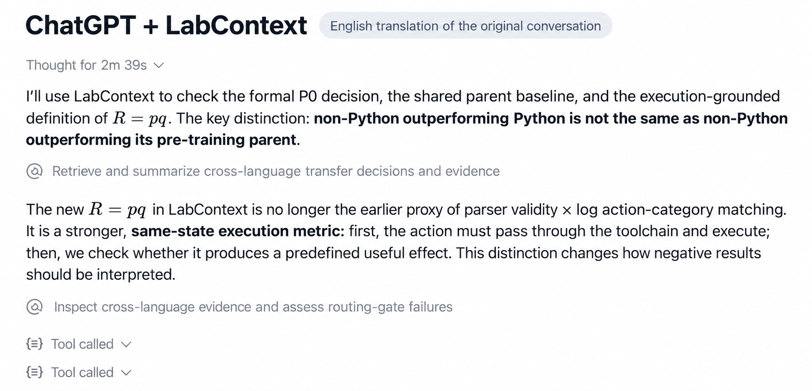
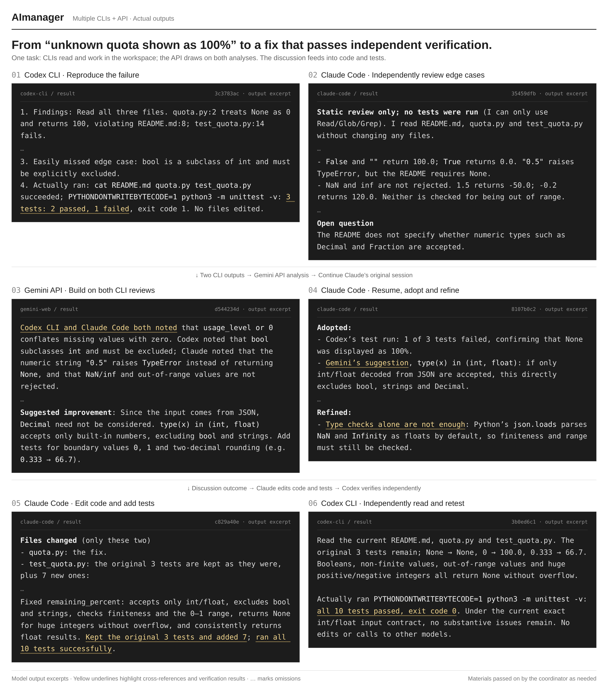
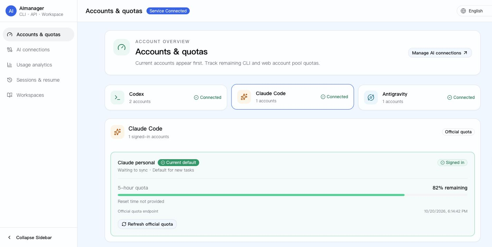
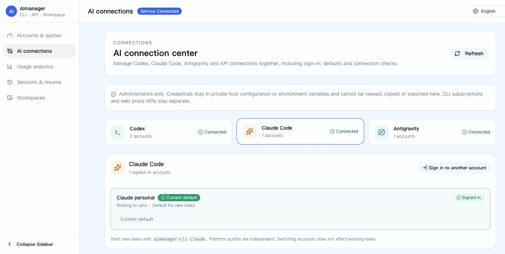
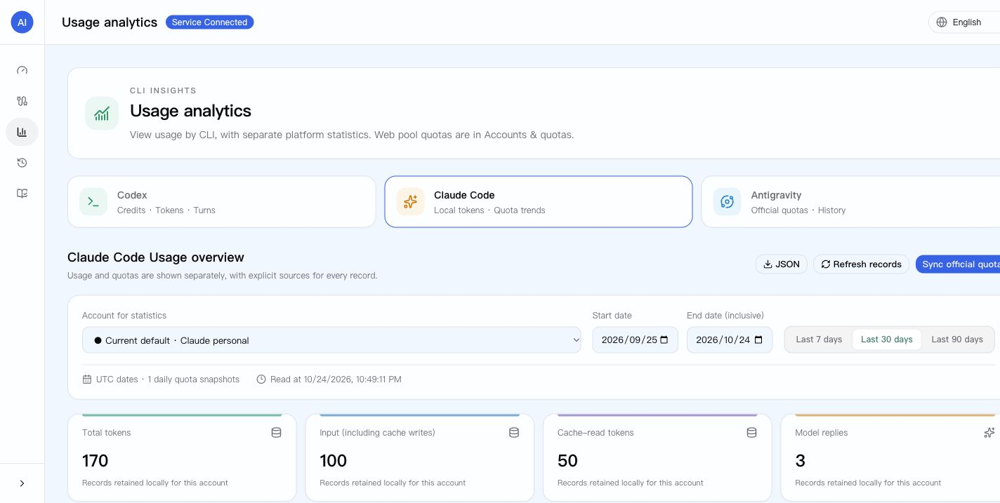
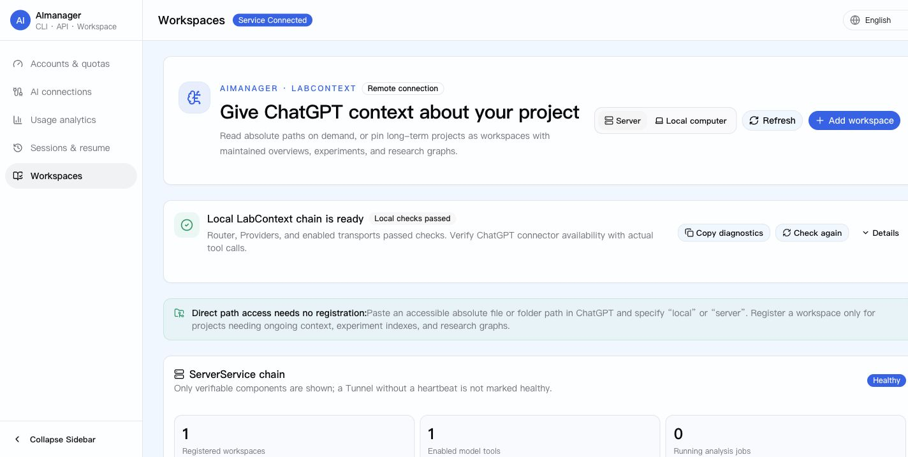

<h1 align="center">AImanager</h1>

<p align="center"><a href="README.md">English</a> · <a href="README.zh-CN.md">简体中文</a> · <strong>Русский</strong> · <a href="README.ko.md">한국어</a></p>

<h3 align="center">Получайте больше пользы от своего ИИ</h3>

<p align="center">Контекст проектов для ChatGPT.<br />Совместная разработка и взаимная проверка силами CLI-агентов и моделей через API.</p>

<p align="center"><a href="https://github.com/3241288994/AImanager/actions/workflows/ci.yml"></a> · <a href="LICENSE">MIT License</a></p>

<p align="center"></p>

**Контекст проектов, совместная работа моделей и управление AI-аккаунтами.**

ChatGPT получает через MCP доступ к разрешённым файлам на вашем компьютере и сервере: коду, статьям и результатам экспериментов. Не нужно каждый раз упаковывать и загружать проект.
Из привычного агента можно вызывать Codex CLI, Claude Code и модели через API, передавать выбранные материалы, сравнивать решения, вносить разрешённые изменения и независимо проверять результаты.
В одном интерфейсе собраны вход в аккаунты, выбор активного аккаунта, квоты, статистика и восстановление CLI-сессий.

## Как это выглядит

### ChatGPT отвечает с опорой на файлы проекта

В исходном диалоге ChatGPT использовал LabContext для поиска решений по экспериментам и подтверждающих материалов. Ниже — **английский перевод исходного диалога**, а не снимок нового выполнения.



**Указать путь → посмотреть каталог → прочитать ключевые файлы → объяснить проект или результаты.**
Разовое чтение разрешённого пути не требует регистрации рабочего пространства. Для длительной работы можно сохранить проект как workspace.
[Подключение ChatGPT](docs/open-source/03-openai-plugin-and-tunnel.md) · [Разрешённые каталоги](docs/local-workspaces.md)

### CLI и API: обсуждение, исправление и независимая проверка



[Оригинальное разрешение: 3360 × 3814](docs/assets/en/aimanager-collaboration-demo.png?raw=true)

Это английская локализация подборки исходных ответов из изолированного примера: сохранены шесть шагов, код и жёлтые выделения; многоточия обозначают пропуски. Это не отдельный повторный запуск.
Codex воспроизводит ошибку, Claude независимо анализирует крайние случаи, Gemini сопоставляет оба анализа. Claude уточняет решение и в отдельной разрешённой задаче меняет код; Codex независимо запускает тесты. В записанном примере **прошли все 10 тестов**.

Координатор передаёт только необходимые материалы. API-модель не получает неограниченный доступ к файлам; редактирование и выполнение требуют явного разрешения.
[Пример и записи вызовов](docs/demos/collaboration-demo.md) · [Руководство](docs/ai-collaboration.md) · [Границы проверки](docs/collaboration-validation.md)

## Зачем нужен AImanager

- **Работайте в привычном агенте.** Общий skill и лёгкий инструмент вызова связывают модели без отдельной постоянно работающей платформы оркестрации.
- **Сравнивайте выводы на реальных материалах.** CLI изучает рабочее пространство; API получает выбранный контекст; результаты и разногласия возвращаются участникам.
- **Повторно используйте рецепты задач.** Есть четыре редактируемых рецепта: независимая проверка, планирование и выполнение, научное обсуждение, работа с текстом.

Автоматическое извлечение, проверка и обновление рецептов по результатам работы — **планируемая, ещё не реализованная возможность**.

## Примеры запросов

```text
Посмотри /Users/me/Documents/project на моём компьютере.
Найди точки входа и объясни структуру проекта.

Прочитай /srv/research/paper-a/README.md на сервере и результаты
в каталоге results. Кратко опиши текущее состояние экспериментов.

Вместе с opus5.5 независимо предложите решения, обсудите различия
и внесите согласованные изменения.
```

Пути должны входить в разрешённые каталоги. Имена вроде `opus5.5` и `gemini4` — примеры пользовательских псевдонимов, а не обещание доступности конкретных моделей.
Для запуска совместной работы из веб-интерфейса нужен дополнительный MCP-мост; выполнение по умолчанию выключено.

## Три компонента совместной работы

| Компонент | Назначение |
| --- | --- |
| Общий skill | Распределение задач, подготовка контекста, обсуждение и проверка результатов |
| `ai-collab` | Вызовы CLI/API, задачи, результаты, продолжение диалогов и границы разрешений |
| Рецепты | Повторно используемые требования к материалам, роли и этапы проверки |

Роли и число раундов не фиксированы. Важные решения сначала оцениваются независимо; факты проверяются по источникам, рассуждения — по предпосылкам, компромиссы — по требованиям пользователя.

## Аккаунты, квоты и сессии

| Возможность | Назначение |
| --- | --- |
| Подключения | Вход и выбор аккаунтов Codex, Claude Code, Antigravity; частные API и проверки связи |
| Квоты | Окна квот, время сброса и снимки состояния отдельно по платформам |
| Веб-пулы | Доступность поддерживаемых пулов, тарифы, квоты и устаревшие данные |
| Аналитика | Доступные каждой платформе данные об использовании и истории квот |
| Сессии | Поиск на хосте сервиса и команды продолжения для нужного аккаунта |
| Workspaces | Обзоры, доказательства, эксперименты, задания анализа и исследовательские графы |
| Диагностика | Проверки Router, Provider, SSH, Tunnel и безопасное восстановление |

Неизвестные значения остаются неизвестными. Codex показывает Credits, токены, историю, экспорт JSON/CSV и справочную оценку USD. Токены Claude считаются по сохранённым журналам сессий на хосте сервиса; Antigravity использует снимки квот при отсутствии надёжных данных о токенах.
**Квоты разных платформ не суммируются, а справочная стоимость не является счётом.**



<details>
<summary>Подключения, аналитика и рабочие пространства</summary>







</details>

Снимки показывают части английского интерфейса с изолированными демонстрационными данными, а не реальные аккаунты и остатки квот. Все иллюстрации этой версии используют английские ресурсы.

## Установка

| Режим | Доступ |
| --- | --- |
| `local` | Явно разрешённые каталоги компьютера |
| `server` | Явно разрешённые каталоги сервера |
| `hybrid` | Оба источника через одно подключение ChatGPT |

Provider читает файлы, Router маршрутизирует инструменты, Tunnel обеспечивает частное MCP-подключение. Права на каждом хосте задаются отдельно.
Поддерживаются код и текст, HTML, текстовые PDF, DOCX, XLSX, PPTX и IPYNB. Для сканов нужен OCR; действуют ограничения размера, глубины каталогов и объёма ответа.

Передайте своему агенту:

```text
Установи или обнови https://github.com/3241288994/AImanager .
Режим: <local | server | hybrid>
SSH Host: <существующий псевдоним; убрать для local>
Разрешённые каталоги: <абсолютные пути отдельно для компьютера и сервера>

Сначала прочитай AGENTS.md, INSTALL.md и связанные инструкции.
Сохрани аккаунты, базу, конфигурацию и секреты; используй существующий SSH.
Проверь поддержку ai-collab и настрой только указанные мной каналы.
Для авторизации на официальных сайтах дай мне конкретные шаги.
Выполни проверки из инструкции и сообщи результаты.
```

Полная инструкция: [INSTALL.md](INSTALL.md). Подробные эксплуатационные документы пока преимущественно на китайском; локализованные README служат точками входа.

Опубликованный инструмент совместного выполнения требует **Linux и Python 3.8+**:

```bash
python3 scripts/install-ai-collab.py
ai-collab init
ai-collab doctor
ai-collab resolve opus5.5
ai-collab run --model opus5.5 --workspace /path/to/project --prompt "Review this project"
ai-collab wait JOB_ID --timeout 30
ai-collab result JOB_ID
ai-collab reply JOB_ID --prompt "Suggest specific improvements"
```

Добавьте `~/.local/bin` в `PATH`. По умолчанию skill устанавливается для Codex; для другого агента используйте `--skill-dir` и откройте новую сессию.
`doctor` проверяет предпосылки подключения, а не правильность результатов. Разрешения на изменение и выполнение задаются явно.
Есть адаптеры Codex CLI, Claude Code и Gemini API. Управление аккаунтами Antigravity **не означает** наличия адаптера совместного выполнения. Требование Linux относится к опубликованному инструменту совместного выполнения, не ко всем компонентам проекта.

## Восстановление и безопасность

```bash
labcontext status
labcontext doctor
labcontext repair
```

Либо используйте восстановление в центре подключений. Профили Tunnel отделены от рабочих пространств для последующей смены аккаунта ChatGPT: [инструкция](docs/chatgpt-account-switch.md).

- Открывайте только явно разрешённые каталоги. Чтение файлов не даёт права произвольного выполнения.
- Не публикуйте management RPC, базы и токены; по умолчанию службы слушают loopback.
- Не коммитьте секреты и рабочую конфигурацию. Переданный моделям контекст регулируется политиками выбранного провайдера.
- ChatGPT подключается к MCP Router, а не к management RPC. Путь рабочего пространства не является полноценной границей контейнерной изоляции.

## Документация и разработка

[Установка](INSTALL.md) · [Рабочие пространства](docs/local-workspaces.md) · [Аккаунты](docs/ai-connections.md) · [Совместная работа](docs/ai-collaboration.md) · [Аналитика](docs/usage-analytics.md) · [Сессии](docs/cli-sessions.md) · [Тестирование](TESTING.md)

Для сборки нужны Node.js 20+, Python 3.11+, Rust stable и платформенные зависимости Tauri для desktop:

```bash
corepack pnpm@10.30.3 -C apps install --frozen-lockfile
corepack pnpm@10.30.3 -C apps run build:desktop
corepack pnpm@10.30.3 -C apps run test:runtime
cargo test --workspace --locked -- --test-threads=1
scripts/open-source/preflight.sh
```

UI и desktop: `apps/`; сервисы и хранилище: `crates/`; файлы и контекст: `labcontext-provider/`; адаптеры: `scripts/ai_collab/`; skill и рецепты: `skills/multi-model-collaboration/`.

## Лицензия и происхождение

[MIT License](LICENSE). Проект развивается на основе MIT-кода `qxcnm/Codex-Manager`; см. [NOTICE](NOTICE) и [THIRD_PARTY_NOTICES.md](THIRD_PARTY_NOTICES.md).
[Участие в разработке](CONTRIBUTING.md) · [Сообщить об уязвимости](SECURITY.md).

Имя продукта и репозитория — **AImanager**. Старые имена `codexmanager-*`, переменные окружения и пути данных сохраняются для совместимости; переименовывать рабочие данные не нужно.
