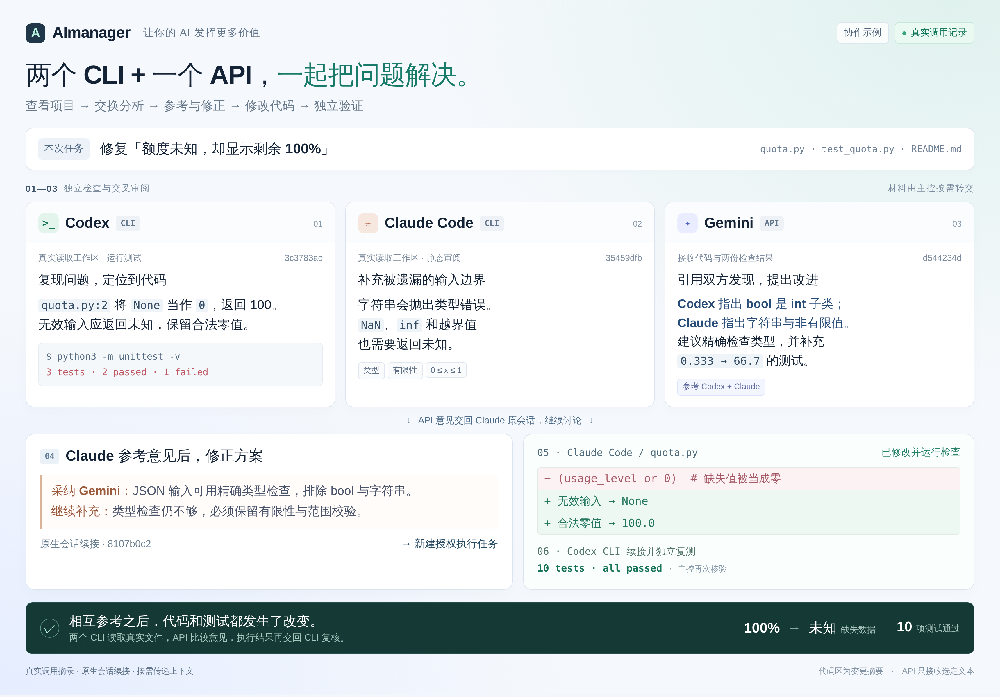

# 轻量多模型协作

**把你常用的 CLI 和 API 模型搭配起来，一起完成任务。**

这套方案暂不另取名称。你可以在当前使用的 Agent 中点名其他模型，共同设计、
审阅和执行。命令仍为 `ai-collab`，skill 标识仍为 `multi-model-collaboration`。

架构与取舍见 [方案](collaboration-runtime-design.md) 和 [接口设计](collaboration-interface-design.md)。
本文描述 0.2.0 的实际接口；设计文档中的远期扩展不表示已经支持。

## 先看一次协作如何衔接



上图汇集了隔离示例的真实调用：Codex CLI 运行测试复现问题，Claude Code 独立审阅输入边界，
Gemini API 结合代码和两份意见提出建议；Claude 续接讨论、修正方案，再新建授权任务修改代码，
由 Codex 独立复测，主控再次核验，最终 10 项测试通过。
[本次调用记录与可复现示例](demos/collaboration-demo.md)包含原始结果文本、修改前后代码和测试。
这是可调整的分工，不是角色限制或必跑流水线。CLI 和 API 都能参与讨论，区别在于工具和文件权限。

信息经主控按需转交：`run` 新建任务，`reply` 继续原会话，`run --after` 将一个已完成任务的结果
传给新任务。它们不代表模型自动直连或共享全部文件。`reply` 不能提升原任务的权限；
从只读分析转为修改时，需要新建明确授权的 `exec` 任务。其他渠道与权限验证见[记录](collaboration-validation.md)。

## 三个卖点

### 1. 轻量自由，你的 AI 你来组合

在已有 Agent 中安装 skill 和小工具即可使用，不增加常驻调度服务。
谁负责、请谁帮忙、用什么模型、怎样分工，可以按任务调整；不要求照固定流程走。
模型升级后可以更新映射，已有的协作方式继续使用。

面向不同 CLI/API 扩展是设计目标。当前已接入 Claude Code、Codex CLI 和 Gemini API
渠道；新增渠道需要编写适配器，不能理解为任意 CLI/API 已经即插即用。

### 2. 让 CLI 和 API 都用上真本事

CLI 协作者可以进入真实工作区，自己找文件、分析问题，在授权范围内修改和运行检查。
API 模型拿到相关材料后，可以提出方案、补充思路、审阅结果、参与写作。
两边都能讨论和推理，分工随任务调整；文件、检查结果和建议可以由主控转交，
继续上一轮工作，不必反复从头解释。

例如改一个项目：Claude Code 查看源码并提出方案，API 模型分析其中的取舍；
方案调整后，由有权限的 CLI 修改和测试，再把实际结果交给其他参与者复核。
这是一种用法，不是必跑流程。

### 3. 好用的做法留下来，下次不用从头教（规划中）

目标是在日常协作后自动整理有效做法：什么任务、怎样分工、哪些步骤有用、
在什么条件下适用，以及结果依据。下次遇到类似任务时按需复用，效果不好时修订。
积累的是可以查看、修改的配方，不是重新训练模型。

当前已有任务记录和四份可选配方，**还没有自动提炼、验证和写回配方的机制**。
后续自动沉淀应先保留为候选经验，不因一次成功就写成通用规则；
共享配方只保存可复用方法，不夹带私密原文或凭据。

## 三部分分别有什么用

| 部分 | 通俗解释 | 为什么需要 |
|---|---|---|
| 通用 skill | 协作说明：怎样分工、给什么材料、如何讨论和收尾 | 减少每次重新教 AI 怎样合作 |
| `ai-collab` 工具 | 调用工具：真正启动 CLI/API 任务、取回结果、接着聊 | 统一不同渠道的调用方式，减少手工拼命令和转交结果 |
| 配方 | 可复用的做法：这类任务通常怎样配合、需要什么材料 | 类似任务可以参考已有经验，简单任务也可以不用 |

**Skill 教怎么合作，工具负责调用，配方保存做法。**
三部分分开，模型或渠道变化时主要改适配和配置；某类任务有了更好的做法时更新配方，
不用重写整套协作规则。配方当前支持人工维护，自动沉淀属于上面的后续方向。

## 如何把讨论变成有效合作

主控先识别当前需要共同设计、成果审阅，还是解决一项决策；它们不是必跑的三个阶段。
重要设计先各自形成初步判断，再围绕少量关键差异交流：

- 事实分歧查来源，推理分歧查前提和反例，取舍分歧对照用户的实际要求。
- 允许组合出更好的候选方案，同时检查复杂度、兼容性和约束。
- 改变建议时说明新依据：证据、推理修正、需求澄清或更好的构造；意见一致不等于正确。
- 有新的决策价值才继续讨论；没有必要时直接完成，不为凑轮次制造分歧。

独立审阅使用新 `run`，提供待审成果和原始材料，不附此前背书；独立重新设计则也不提供
旧方案。`reply` 延续讨论，`run --after` 传递结论，都不能作为新的盲审。
完整规则见 [讨论指南](../skills/multi-model-collaboration/references/discussion.md)。

## 安装和使用

要求 Linux、Python 3.8+。执行层只使用标准库；进程身份核验依赖 `/proc`。

```bash
python3 scripts/install-ai-collab.py
ai-collab init
ai-collab doctor
ai-collab resolve opus5.5
ai-collab run --model opus5.5 --workspace /project --prompt "审阅项目，指出具体问题"
ai-collab run --model opus5.5 --access exec --workspace /prepared-task --prompt-file task.txt
ai-collab run --model gemini4 --file evidence.txt --prompt "比较这些方案的优缺点"
ai-collab wait JOB_ID --timeout 30
ai-collab result JOB_ID
ai-collab reply JOB_ID --prompt "请根据上一轮材料进一步分析"
```

`run` 返回后台任务，提交成功不等于任务完成。`result` 仅返回成功任务。
`reply` 继承原模型、渠道、原生账号、目录和权限；CLI 恢复原生 session，API 发送
完整保存的 messages。只续接最新成功且可续接的任务；旧版本非持久化任务不能续接。
如果某轮续接失败或取消，会话冻结：原生上下文可能已经部分改变，不能安全重放。
核对工作区与日志后，用 `run --after` 和明确选取的材料启动新任务。
`run --after JOB_ID` 仅把结果交给一个新任务，适合交叉审阅，不表示复制会话。

同一会话不能并发续接，同一目录及其父子目录不能同时执行两个写任务。
主控可自行创建 Git worktree 或独立输出目录；工具不会自动合并或删除它们。
`jobs --workspace /project` 过滤相关任务。`cancel` 停止本地调用，独立启动的实验
可能仍在运行，需要实验自己的任务句柄。

安装器默认装到 `~/.local/bin` 与 `~/.codex/skills`；通过 `--skill-dir` 安装到
其他 harness 的 skill 目录。同一份 skill 不依赖特定主控。未受管理的同名 skill
不会被覆盖。新增 skill 通常需新开会话发现。
安装入口通过 `AI_COLLAB_HOME` 固定所属用户的配置根，避免 Claude 等隔离账号
改变 `HOME` 后丢失模型映射；显式 `AI_COLLAB_CONFIG` / `AI_COLLAB_STATE_DIR` 仍优先。

## 适配器与权限

| 适配器 | 输入与能力 | 续接 |
|---|---|---|
| Claude Code | text；指定目录的 read；显式 exec | 原生 session ID |
| Codex CLI | 一个指定目录的 read / exec | 原生 thread ID |
| Gemini 网页反代兼容 API | 文本与显式附件；不读取服务器目录 | 保存的 messages |

不指定工作区默认 text，指定工作区默认 read。`--access exec` 必须指定一个目录。
Claude read 使用 2.1.304+ 的 Read/Glob/Grep、restricted 与 safe-mode。
Claude exec 使用原生 Bash sandbox，需要 bubblewrap 与 socat，禁用无沙箱回退，
可以通过 `claude.sandboxPath` 增加已有依赖目录。原生 Bash 文件系统可见范围与
文件工具不同，**不能把它理解为所有读取均严格限制到项目目录**；执行不可信仓库
应另行使用容器/独立系统账号。工作区内容是实时读取，不是不可变快照。
Codex 适配器已在 CLI 0.163.0 验证，使用命名权限配置、禁用任务网络、禁用额外
子代理和权限提升；read 可运行受沙箱限制的只读命令。
两个适配器均禁用额外 hooks/MCP，不使用 yolo 或跳过权限模式。

模型名与路由存在个人配置，不写死在 skill：

```bash
ai-collab alias set codex-model --provider codex-cli --model VERIFIED_MODEL_ID
ai-collab alias default codex codex-model
ai-collab alias set future-model --provider claude-code --model VERIFIED_MODEL_ID
```

Codex 读取 `codex.home`（默认 `~/.codex`）现有 ChatGPT 登录，执行文件由
`codex.binary` 指定；不切换到 API key。Claude 复用 AImanager 管理的 OAuth。
Gemini 凭据引用 `~/.config/gemini-web-client/client.env`；环境变量可指定初始
端点，任务创建后端点固定。账号池仍可能选用不同上游账号，响应可用时记录实际账号。
模型 metadata 表示供应方声明；Codex 若未输出模型 metadata，则如实标注
`explicit_request_only`，不冒充独立鉴定。

## 远程与可选 MCP

在个人配置中声明 SSH host：

```json
{"hosts":{"server":{"ssh":"my-server","entrypoint":"~/.local/bin/ai-collab"}}}
```

此处片段合并到现有配置。目标服务器需已安装并配置 `ai-collab`。

```bash
ai-collab run --host server --model opus5.5 --workspace /remote/project --prompt "审阅入口"
ai-collab status server:JOB_ID
ai-collab reply server:JOB_ID --prompt "继续分析"
```

SSH 只运行固定入口，任务通过 JSON stdin 传递，不把 prompt 拼进 shell。
`--file` 是调用端显式附件，`--workspace` 是执行端路径。未配置 host 会直接失败。
通信超时后先查任务，不自动重复提交。

可选 stdio MCP 使用 `ai-collab mcp`。LabContext 也可以注册同样的七个工具，
不新增 HTTP 服务或数据库；Router 为任务 ID 加来源限定。
必须先在个人配置启用范围策略：

```json
{"mcp":{"enabled":true,"models":["opus5.5","gemini4"],"allowedRoots":["/project"],"allowExec":false}}
```

MCP 只能查询通过此桥创建的任务，每次查询/续接重新核对模型与目录策略。
`allowExec` 默认关闭；启用后仍须调用者对具体任务明确授权。策略修改后发现工具
可能需要重启 Provider、刷新 Router 与 Connector 元数据。此适配不改变原 Provider
配置、认证、文件解析器或工作区注册信息。

## 边界与诊断

配置：`~/.config/ai-collab/config.json`，可由 `AI_COLLAB_CONFIG` 覆盖。
任务：`~/.local/state/ai-collab/`，可由 `AI_COLLAB_STATE_DIR` 覆盖。
每项任务保存私有输入、配置快照、状态、结果与原始日志；不提交 Git。
每个附件最多 256 KiB，最多 20 个，总输入/对话历史最多 1 MiB，输出最多 4 MiB。
不静默截断；超出预算需主控显式选取材料后开新任务。最多四个活动任务，默认超时
600 秒，可设 5–1800 秒。`--dry-run` 不发起推理。

所有普通命令输出 `schemaVersion/ok/data` 或 `error` JSON；stdio MCP 使用 JSON-RPC。
状态为 queued/running/succeeded/failed/cancelled/timed_out/interrupted。
`doctor` 只验证配置与发现，不证明推理成功；`succeeded` 表示调用完成，模型拒答或
错误结论仍需主控识别。失败不自动重试，不自动降级模型或替换计费渠道。

四份配方位于 `skills/multi-model-collaboration/recipes/`：独立审阅、计划与执行、
科研讨论、写作。只在任务需要时读对应配方，不将它们变成每次必跑的固定流水线。

依据：[Claude 非交互调用](https://code.claude.com/docs/en/headless)、
[Claude sandbox](https://code.claude.com/docs/en/sandboxing)、
[Codex 配置](https://learn.chatgpt.com/docs/config-file/config-reference)。
