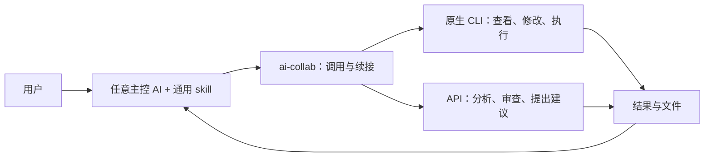

# AImanager 合奏：轻量协作方案

日期：2026-10-21  
状态：轻量首版已实现为 `ai-collab 0.2.0`。此版根据用户反馈替代上一版重运行时方案。

三部分的设计取舍见[接口定稿](collaboration-interface-design.md)；实际命令、已支持边界和安装方式以[使用说明](ai-collaboration.md)为准。

## 1. 设计宗旨

**让用户在自己喜欢的 AI 中，随时借用另一个 CLI 或 API 的能力。**

足够轻量、充分利用已有工具、按需协作、主控可替换。采用现有优秀思路，提炼成小工具与通用协作约定；不以算法创新、研究基准或自动化平台为前提。

用户只需说“让 opus5.5 看这个项目”“和 gemini4 讨论方案”“让 Claude 在服务器跑这个实验”。模型别名、账号和主机在配置中维护，模型升级不改工作流。角色随任务分配，不永久指定某个厂商负责执行或审查。

## 2. 只保留三个组成部分

| 部分 | 职责 |
| --- | --- |
| 一份通用协作 skill | 主控决定何时请人、提供什么材料、如何讨论、何时收尾 |
| 现有 ai-collab 小工具 | 解析名字、调用 CLI/API、启动后台任务、查询结果、取消与续接 |
| 少量 Markdown 配方 | 为审查、写作、idea、实验、业务分析提供可选提示，不强制流程 |

状态沿用现有 job 文件目录。终端主控直接调用 CLI；网页版等不能使用 shell 的入口，通过薄 MCP 包装调用同样的 job 能力。MCP 包装不是另一套状态或编排引擎，CLI 用户无需额外常驻服务。

网页版接入优先复用已经部署的 LabContext/Router 与鉴权通道；工具实现仍在独立协作模块，文件解析模块不承担任意 shell 执行。新用户没有这些服务时，网页版入口确实需要部署可访问且有鉴权的服务，不能宣称零服务。只开放已配置参与者、目录和操作范围，不直接暴露任意命令。

AImanager 提供已有账号、模型别名、主机和会话管理，后续可以展示协作结果。不开网页也能协作。

## 3. 借鉴与取舍

| 来源 | 提炼采用的思路 |
| --- | --- |
| [ARIS](https://github.com/wanshuiyin/Auto-claude-code-research-in-sleep) | Markdown 工作流、主执行者与独立复核、模型桥接；只取需要的配方，不整套搬入 |
| [CLI Agent Orchestrator](https://github.com/awslabs/cli-agent-orchestrator) | 保留原生 CLI 自主能力，委派到独立会话；优先使用 headless 调用，交互式需求出现后再考虑终端管理 |
| [Aider architect/editor](https://aider.chat/2024/09/26/architect.html) | 分析与执行可以由不同参与者承担，再围绕实际成果交流 |
| [Agent Relay](https://github.com/AgentWorkforce/relay) | 参考跨 CLI 通信方式；当前主控转交结果足够，不引入消息总线 |

这是思路层面的借鉴，不表示已经集成这些项目。若实际复制代码或配方，需要保留对应许可证和署名。

## 4. 充分使用 CLI 和 API 各自的能力

### 原生 CLI：给目标和目录，让它自己工作

传入工作目标、主机、工作目录、必要材料、允许的操作和期望交付。文件搜索、工具循环、编辑、shell、上下文压缩与原生会话交给 harness 本身。

0.2.0 已支持只读模式及显式 `--access exec`，原生权限与会话恢复经过验证，
具体范围见[使用说明](ai-collaboration.md)。项目说明可以提供给协作者，但不能因需要
说明文件就自动启用全部 hooks 或配置。worktree 和编辑确认模式都不等于安全沙箱。
一次任务的能力由实际适配器、环境与授权共同决定，讨论建议不会自动扩大调用权限。

### API：给适量材料，允许继续问答

API 使用文本和可支持的其他输入来分析、比较、审查、写作。需要文件内容时，先复用 LabContext 的读取与解析能力，保留来源和截断信息；不直接将服务器路径当作 API 已读到的内容。

缺少信息时，协作者写“还需要什么”。主控判断后补给并继续，不必另造自动取证协议。结果中的命令或信息请求只是建议，不自动获得执行权限。

如果未来 API 支持工具调用，可通过适配器扩展；不把“API 永远无工具”写成框架限制。

### 用一个调用入口表达不同任务

继续使用 run，不再增加咨询、辩论、执行等独立子系统。角色、工作目录、访问方式与提供方能力决定实际行为；不支持的组合明确报错。

结果保留自然语言，只约定四项信息：结论、交付文件、实际做过的检查、未解决问题。简单咨询无需凑齐空字段；文件与测试记录按需返回，不强制完整任务 schema。

检查说明首先是协作者的执行报告；主控根据日志、文件或实际重跑核实，不能将自述直接当成独立验证。

## 5. 连续讨论与接力

- CLI 支持原生续接时，保存会话 ID，后续优先继续该会话。
- 续接要保持原提供方、模型、账号、主机和权限兼容；不兼容时明确新建会话并附交接材料。
- API 保存必要的显式历史；历史过长时由主控选择摘要和材料，不无限回放。
- 同一原生会话串行续接，不向仍在工作的会话强塞第二个任务。
- 当前 --after 是传入前次结果，不能伪装成原生会话续接；两种能力应分别说明。

默认由一个主控和一个协作者完成任务，确有独立工作再增加参与者。已有后台 job 负责长调用，主控可以继续自己的工作，随后读取结果。

主控换人采用显式交接：停止旧主控继续分派，新主控查看相关 job 和一份短摘要：目标、已完成、正在运行的任务、关键文件、下一步。复杂任务才需要交接文件；简单问答读取 job 即可。不做自动选举，不要求原生聊天跨厂商复制。

## 6. 工作目录与服务器

| 工作情况 | 最简单的处理 |
| --- | --- |
| 查看代码或资料 | 直接读取指定目录 |
| Git 项目并行修改 | 每个协作者独立 worktree，主控决定是否合并 |
| 非 Git 的论文、实验或办公文件 | 使用独立输出目录，返回文件或修改建议 |
| 必须直接修改原目录 | 明确文件范围并串行安排，避免同时写同一份文件 |
| 服务器任务 | 在目标服务器安装同一个小工具，沿用已有 SSH 和命名主机配置 |

首版远程使用固定配置的主机和工作目录，不接受模型结果直接变成 SSH 命令。CLI 原生会话和 job 留在执行主机；跨机器路径不会自动可见，材料需经现有文件读取或明确传递。

无需自建远程 Runner 网络、消息服务或文件锁平台。长实验用现有后台进程/作业系统；保存句柄和结果位置，失联先查状态，不自动重跑。

直接修改原目录时，小工具需要在本机以简单原子互斥检查防止自身同时启动两个冲突任务；这不需要常驻锁服务，也不保证约束工具之外的手工编辑。并行工作优先使用独立输出目录或 worktree。

## 7. 配方保持短小且可选

每份配方只写：适合什么任务、需要哪些材料、怎么分工、交付什么、主控如何收尾。约十几行即可；不使用 DSL，不变成必须逐阶段执行的管线。

| 配方 | 示例 |
| --- | --- |
| 独立复核 | 协作者直接查看材料，先给自己的判断，再讨论主控意见 |
| 方案→实现 | API 或 CLI 分析方案，具备执行能力的 CLI 实现并反馈结果 |
| idea 探索 | 独立提出方向/反例，再补关键文献或事实，不强制安排新实验 |
| 论文写作 | 提供段落与依据，审查逻辑、引用、表述，主控整合 |
| 实验任务 | 明确目标、数据、命令/环境范围，CLI 自主执行，返回日志和结果 |
| 业务处理 | 给资料与业务约束，形成分析、文档或草稿，按任务要求核对 |

不会为体现协作而每一步都调用其他模型。已得到有用答案、材料不足或达到约定轮次时即可收尾。

## 8. 保留少量可靠性，去掉平台负担

保留现有明确的模型绑定、超时、取消、后台状态、错误原因和输入范围。保持有限反馈轮次，不静默换模型或重复有副作用的任务。主控根据工作内容核对成果：代码看 diff/测试，实验看日志/指标，文稿看来源/论证。

不建设中心数据库、独立控制面、主控租约、验证平台、消息总线、学习型路由、工作流画布或科研评测体系。以后只有实际需求证明必要时，才单独补充。

“完成”表示该次调用结束，不表示成果自动正确。任务报告写清已做/未做即可，不要求另建验收状态机。

## 9. 最小增量顺序

1. 将现有 skill 中固定 Codex 主控的表述改为任意当前主控；补齐实际可用的原生 CLI 适配，避免只改文案却无法互相委派。
2. 核实并补齐原生会话续接、API 显式历史；保留简单 --after 使用方式。
3. 加入明确的工作区执行方式，Git 使用 worktree，其他任务使用输出目录或串行修改；按原生能力落实边界。
4. 添加少量可选配方，复用现有 LabContext；为网页版提供薄 MCP 入口。
5. 需要远程调用时沿用现有 SSH 配置接入。AImanager 页面展示按实际使用需求迭代，不作为 CLI 协作前置条件。

只做基本功能核对：两轮续接是否真实有效、工作目录是否正确、文件是否落到约定位置、后台结果能否取回、另一主控是否能读懂交接。无需先立新课题或跑大规模基准。

## 10. 讨论记录

本版基于用户关于轻量化的纠正，继续通过 ai-collab 与 Claude Code 的 opus5.5 讨论。主控核对公开项目资料，Opus 读取现有协作实现并提出删减方案。提供方报告模型为 claude-opus-5-5。

本轮共进行了两次模型讨论。采纳了原生续接兼容性、简短交接材料和执行报告语义；修正了将 worktree 当权限边界的建议。Opus 倾向将执行能力整体后置，主控未采纳：执行正是用户强调的核心价值，应在核实原生能力后作为首批增量，而非无限推迟。网页版服务复用现有部署，额外部署需求据实说明。

上一版偏重控制面、研究贡献和评测，已从当前方案移除。现有服务、配置和权限均未因本次设计讨论发生改变。
